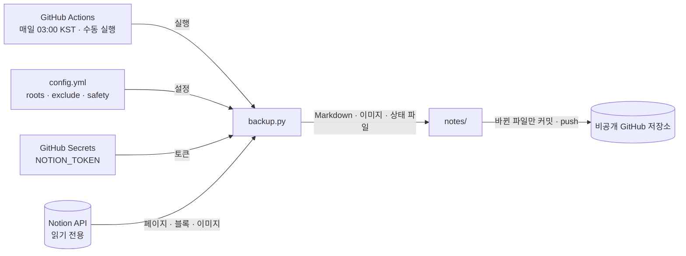

# Notion 강의 필기 자동 백업 명세서

Nov 20, 2026 · 개정 Nov 23, 2026 · @yu

## 1. 개요

노션 강의 필기를 매일 자동으로 Markdown 파일로 변환해 비공개 GitHub 저장소에 보관한다. 노션 서비스 장애, 계정 문제, 정책 변경이 생겨도 필기를 잃지 않고 노션 없이 읽을 수 있게 하는 것이 목적이다.

**목표**

- 사람이 손대지 않아도 매일 백업된다.
- 백업본은 노션 없이 GitHub 웹과 Obsidian에서 읽을 수 있다.
- 변경 이력이 git에 남아 과거 시점의 필기를 복구할 수 있다.
- 코드에 개인 정보가 없어 템플릿으로 공유한다. 템플릿 저장소: https://github.com/hluuy/notion-backup-template (8.5절)

**비목표**

- 백업본을 노션으로 되돌리는 복원 기능은 만들지 않는다.
- 백업본에서 수정한 내용을 노션에 반영하지 않는다. 백업본은 읽기 전용으로 본다.
- 노션의 모양(배경색, 열 배치 등)을 완벽히 재현하지 않는다. 내용 보존이 우선이다.

## 2. 결정 사항 요약

아래 12가지는 확정된 내용이며, 이후 절은 이를 자세히 정의한다.

| 항목                      | 결정                                                                                                                        | 상세     |
| ------------------------- | --------------------------------------------------------------------------------------------------------------------------- | -------- |
| 필기 형태                 | 일반 페이지와 데이터베이스 모두 처리                                                                                        | 6절      |
| 백업 범위                 | 노션에서 통합을 연결한 페이지와 그 하위 전체. 최상위 페이지는 자동 인식하고 `config.yml`의 `roots`로 보강, `exclude`로 제외 | 4절, 7절 |
| 백업 대상                 | 텍스트와 이미지만, 첨부파일은 자리 표시만                                                                                   | 5절      |
| 업데이트 방식             | 증분 백업, 수정된 페이지만 다시 받음                                                                                        | 4절      |
| 링크 형식                 | 표준 Markdown 상대 링크                                                                                                     | 5절      |
| 콜아웃                    | 인용 박스 + 이모지                                                                                                          | 5절      |
| 토글                      | 제목은 굵게, 본문은 일반 Markdown으로 펼쳐 씀                                                                               | 5절      |
| 파일 이름                 | 제목만, 겹칠 때만 구분자                                                                                                    | 6절      |
| 하위 페이지가 있는 페이지 | 폴더 + `README.md`                                                                                                          | 6절      |
| 삭제된 페이지             | 휴지통에 있음이 확인되거나 `exclude`에 넣은 페이지만 삭제, git 기록으로 복구. 접근할 수 없는 페이지는 사본 보존             | 4절      |
| 실행                      | GitHub Actions, 매일 03:00 KST + 수동 실행 버튼                                                                             | 8절      |
| 저장소                    | 비공개 저장소 하나, 코드와 `notes/` 분리로 템플릿 공유 대비. 공개 저장소에서는 백업하지 않음                                | 3절, 8절 |

## 3. 시스템 구성

백업은 GitHub Actions 서버에서 돌아가므로 내 컴퓨터가 꺼져 있어도 동작하고, 노션에는 읽기만 한다.



GitHub과 Obsidian 모두 Mermaid 다이어그램을 그림으로 보여준다.

Actions가 설정을 읽어 `backup.py`를 실행하고, `backup.py`는 Notion API에서 받은 내용을 `notes/`에 쓴 뒤, 바뀐 파일만 비공개 저장소에 커밋한다.

### 저장소 구조

```
my-notion-notes/                (비공개)
├── backup.py                   ← 실행 시작점
├── notion_backup/
│   ├── client.py               ← API 호출, 재시도, 요청 간격
│   ├── tree.py                 ← 탐색, 최상위 정하기, 순환 재탐색
│   ├── pages.py                ← 페이지 내용 받기, 렌더링, 이미지 준비
│   ├── convert.py              ← 블록을 Markdown으로
│   ├── properties.py           ← 데이터베이스 속성, front matter, 시각
│   ├── images.py               ← 이미지 다운로드
│   ├── paths.py, naming.py     ← 저장 경로와 파일 이름
│   ├── sync.py                 ← 경로 변경 묶음, 반영과 되돌리기
│   ├── lists.py                ← 목차, 데이터베이스 README, CSV
│   ├── state.py                ← 상태 파일과 상태 복구
│   ├── runner.py               ← 한 번의 실행 전체 흐름, 삭제 판정, 안전장치
│   └── log.py                  ← 진행 상황 로그(Actions 화면에 실시간 표시)
├── config.yml                  ← 제외 목록 등 (7절)
├── requirements.txt
├── README.md                   ← 사용 설명서 (11절)
├── docs/명세서.md              ← 이 문서
├── tests/                      ← 변환 스냅샷 테스트 (10절)
├── .github/workflows/backup.yml
└── notes/                      ← 백업 결과물
    ├── README.md               ← 최상위 페이지 목차
    ├── .backup-state.json      ← 상태 파일 (4.1절)
    └── 운영체제/ ...
```

- 코드는 `notes/` 밖에 아무것도 쓰지 않는다. 나중에 템플릿으로 공유할 때 `notes/`만 빼면 된다.
- 코드에는 토큰, 페이지 주소, 이름 같은 개인 정보가 없다. 모두 `config.yml`과 Secrets에서 읽는다.

## 4. 백업 동작

매 실행은 페이지 목록과 수정 시각만 먼저 조회하고, 지난 실행과 비교해 바뀐 페이지만 내용을 다시 받는다.

### 4.1 상태 파일

지난 실행 결과는 `notes/.backup-state.json`에 저장하고 백업 파일과 함께 커밋한다. 페이지 ID마다 다음을 기록한다.

- 저장 경로, 제목, 부모 ID
- `last_edited_time` (탐색 단계에서 본 값, 4.4절)
- 하위 페이지와 하위 데이터베이스 ID 목록(토글, 열, 동기화 블록 안에 있는 것 포함)과 그 목록을 마지막으로 받은 시각(4.2절)
- 이 페이지가 링크하는 다른 페이지 ID 목록
- 이 페이지가 펼쳐 넣은 동기화 블록의 원본 블록 ID와 원본이 있는 페이지 ID
- 데이터베이스 항목이면 속성 값의 해시
- 이 페이지가 쓰는 이미지 목록(블록 ID, 원본 식별자, 파일 경로)과 다운로드에 실패한 이미지 블록 ID (6.5절)
- 마지막으로 렌더링한 시각 (4.5절의 `full_rebuild` 이어받기)
- 내용을 받은 시각과 수정 시각이 2분 이내여서 다음 실행에서 다시 받아야 한다는 표시 (4.4절)
- 접근 불가 상태와 처음 확인된 날짜 (4.5절)
- 연속 실패 횟수 (9절)

페이지별 기록 외에 실행 전체에 대해 다음을 기록한다.

- 지금까지 발견한 최상위 페이지 ID 목록 (4.2절)
- 시간 예산 때문에 끝내지 못한 탐색 대기열(아직 하위를 따라가지 않은 페이지 ID)과 탐색이 끝나지 않은 최상위 목록 (4.6절)
- 데이터 소스마다 목록 조회를 끝까지 마치지 못한 연속 횟수 (4.2절 1-4단계)
- 끝나지 않은 `full_rebuild`의 시작 시각 (4.5절)

Search와 데이터 소스 조회의 커서는 저장하지 않는다. 노션 커서가 다음 날에도 유효하다는 보장이 없고, 그사이 데이터가 바뀌면 결과가 어긋날 수 있기 때문이다.

**상태 파일이 없거나 깨졌을 때**: 전체 백업으로 동작하되, 먼저 `notes/`의 기존 파일에서 상태를 다시 만든다.

- 모든 `.md` 파일의 front matter에서 `notion_id`를 읽어 각 파일이 어느 페이지에 속하는지 되찾는다.
- 이미지는 파일 이름만으로 주인을 알 수 없다. 같은 폴더의 페이지들이 `images/`를 함께 쓰고, 동기화 블록을 펼친 페이지는 원본 페이지의 이미지를 함께 참조할 수 있기 때문이다. 그래서 각 `.md` 파일 안의 로컬 이미지 링크(`images/<블록ID>.<확장자>`)를 읽어 페이지별 이미지 사용 관계를 되찾는다.
- 어떤 페이지도 링크하지 않는 이미지는 지우지 않고 Summary에 "주인을 알 수 없는 이미지"로 표시한다.
- 수정 시각은 믿지 않고 모든 페이지를 다시 렌더링한다. `notion_id`가 없는 파일은 건드리지 않고 Summary에 표시한다.
- 삭제는 4.5절의 확인 절차를 그대로 거치므로, 상태 파일이 없어도 확인되지 않은 삭제는 일어나지 않는다.

### 4.2 실행 순서

1. **탐색**: Notion Search API는 통합이 읽을 수 있는 항목 전체를 돌려준다고 보장하지 않는다([Search API 제한](https://developers.notion.com/reference/search-optimizations-and-limitations)). 그래서 Search 결과에만 기대지 않고, 최상위 페이지에서 시작해 하위를 따라가며 트리를 만든다.
   1. **Search 조회**: Search API로 읽을 수 있는 페이지와 데이터 소스의 ID, 부모, 제목, 수정 시각을 받는다([Notion Search API](https://developers.notion.com/reference/post-search)). 4.6절의 API 버전에서 Search는 데이터베이스가 아니라 데이터 소스를 돌려주므로, 데이터 소스는 부모 데이터베이스 ID로 묶고 데이터베이스의 제목과 설명은 데이터베이스 조회 API로 따로 받는다. 휴지통에 있는 항목은 뺀다. 이 결과는 최상위 페이지 찾기, 수정 시각 비교, 누락 보완에 쓴다. Search는 매 실행 처음부터 끝까지 다시 조회한다. 한 번에 100개씩 받으므로 블록 조회나 렌더링에 비해 비용이 작고, 이전 실행의 커서를 이어 쓰지 않아도 된다(4.1절).
   2. **최상위 페이지 정하기**: 다음을 합친 것이 최상위다.
      - Search 결과 중 부모를 통합이 읽을 수 없는 항목(부모 페이지는 연결하지 않고 그 페이지만 연결한 경우)
      - `config.yml`의 `roots`(7.1절). Search에 잡히지 않는 최상위 페이지를 보강하는 선택 항목이다.
      - 상태 파일에 기록된, 이전 실행에서 발견한 최상위 페이지. 이번 Search 결과에 없으면 페이지 조회 API로 직접 확인한다. Search에서 한 번 빠졌다고 최상위 전체가 사라진 것으로 보지 않기 위함이다.
   3. **하위 따라가기**: 최상위에서 시작해 각 페이지의 하위 페이지와 하위 데이터베이스를 따라간다. 하위 목록은 다음처럼 얻는다.
      - 새 페이지이거나 `last_edited_time`이 바뀐 페이지, `full_rebuild`일 때: 블록을 재귀로 받아 `child_page`, `child_database` 블록을 모은다. 토글, 열, 동기화 블록 안에 있는 것도 포함한다. 결과와 받은 시각은 상태 파일에 저장한다. 이때 받은 블록은 버리지 않고 6단계의 렌더링에 그대로 쓴다.
      - 바뀌지 않은 페이지: 상태 파일의 하위 목록을 그대로 쓴다. 블록을 다시 받지 않으므로 증분 백업의 비용이 유지된다.
      - 수정 시각은 Search 결과에서 가져오고, Search에 없는 페이지만 페이지 조회 API로 받는다.
      - **순환 재탐색**: 바뀌지 않은 페이지의 하위 목록은 낡을 수 있다(4.4절). 그래서 하위 목록을 받은 지 가장 오래된 페이지부터 블록을 다시 받아 하위 목록을 갱신한다. 비용이 매일 고르게 나뉘고, 모든 페이지가 일정 주기로 다시 확인된다. 한 실행에서 순환 재탐색에 쓰는 시간은 모두 합쳐 최대 5분이며, 다음 두 몫으로 나눈다.
        - **우선 몫**: 하위 목록을 받은 지 14일이 넘은 페이지가 있으면, 바뀐 페이지를 처리하기 **전에** 그 페이지들부터 최대 2분 동안 다시 훑는다. 바뀐 페이지가 많은 기간(첫 백업 등)에 순환 재탐색이 계속 밀리지 않게 하기 위함이다. 14일이 넘은 페이지가 없으면 이 몫은 쓰지 않는다.
        - **여유 몫**: 바뀐 페이지를 모두 처리한 뒤 시간 예산(4.6절)이 남아 있으면, 5분 상한에서 우선 몫으로 쓴 시간을 뺀 만큼 가장 오래된 페이지부터 계속 훑는다. 단, 하위 목록을 받은 지 7일이 지나지 않은 페이지는 건너뛴다. 매 실행 모든 페이지를 다시 훑으면 확인 시각만 바뀌어 상태 파일이 매일 커밋되기 때문이다.
        - 주기는 필기 양에 따라 달라지므로 Summary에 "가장 오래된 하위 목록 확인일"을 적는다.
   4. **데이터베이스**: 데이터베이스를 조회해 데이터 소스 목록을 받고, 데이터 소스마다 모든 항목을 페이지를 넘겨가며 조회한다(6.3절). Search처럼 매 실행 처음부터 다시 조회하며, 여러 실행에 걸쳐 목록 조회를 이어받지 않는다. 이미 조회한 구간에서 생긴 수정이나 삭제를 이어받기 기준으로는 잡을 수 없기 때문이다(12절의 추후 과제).
      - **목록 먼저, 렌더링은 나중**: 데이터 소스마다 항목 목록을 먼저 끝까지 받고, 항목 페이지 렌더링은 그다음에 한다. 목록 조회는 한 번에 100개씩 받아 렌더링보다 훨씬 빠르다. 그래서 렌더링과 번갈아 하지 않으면 큰 데이터 소스도 대부분 한 실행 안에 목록을 끝까지 받는다.
      - **목록을 끝까지 받은 경우**: CSV의 속성 값은 목록 조회 결과로 채운다. 항목 파일이 아직 없어도 CSV 행을 만든다(6.3절). 목록 `README.md`의 표에서 이미 렌더링된 항목은 상대 링크로, 아직 렌더링하지 않은 항목(첫 백업 중이거나 이번 실행에서 시간이 모자란 경우)은 노션 원본 URL로 링크한다. 항목 페이지는 시간 예산 안에서 렌더링하고, 남은 항목은 다음 실행에서 이어서 렌더링한다. 이미 렌더링한 항목은 "변경 없음"으로 건너뛰므로 실행할 때마다 앞으로 나아간다. 렌더링된 항목의 링크는 다음 목록 갱신 때 상대 링크로 바뀐다. 항목 삭제 판정도 평소대로 한다.
      - 목록 조회를 끝까지 마치지 못하면 원인에 따라 4.5절 "불완전한 탐색"과 같은 기준으로 처리한다.
        - **API가 `incomplete`를 반환**(오류 쪽): 그 데이터 소스의 목록 `README.md`, CSV, 항목 파일을 모두 그대로 둔다.
        - **목록 조회만으로 시간 예산에 걸림**(시간 쪽): 목록 `README.md`와 CSV는 그대로 두고 항목 삭제 판정도 보류한다. 렌더링은 목록 다음에 하므로, 이 실행에서는 그 데이터 소스의 항목 페이지도 갱신되지 않는다. 같은 실행의 다른 작업이 다음 실행에서 "변경 없음"으로 빨리 끝나면 목록 조회가 더 일찍 시작되어 끝까지 받을 수 있다. 하지만 목록 조회 자체가 시간 예산보다 오래 걸리는 아주 큰 데이터 소스는 이 버전에서 목록, CSV, 항목이 갱신되지 않는다(12절).
      - 끝까지 받지 못한 두 경우 모두 Summary에 데이터 소스 이름, 중단 원인, 목록과 CSV를 이번에 갱신하지 않았음을 표시한다. 첫 백업이라 기존 목록이 없으면 일부 응답으로 목록 `README.md`나 CSV를 만들지 않는다.
      - 목록 조회를 끝까지 마치지 못한 연속 횟수를 데이터 소스마다 상태 파일에 기록한다(4.1절). 3회 연속이면 Summary 맨 위에 "목록을 끝까지 받지 못하는 데이터 소스"로 경고한다. 위의 아주 큰 데이터 소스를 사용자가 알아챌 수 있게 하기 위함이다. 끝까지 받으면 횟수를 0으로 되돌린다.
   5. **누락 보완**: Search 결과에 있는데 트리에 없는 페이지 중, 부모를 따라 올라가면 트리 안의 페이지에 닿는 것은 트리에 넣고 그 부모의 하위 목록을 다음 실행에서 다시 받도록 표시한다. 부모의 수정 시각이 바뀌지 않아 하위 목록이 낡은 경우를 메운다(4.4절).
   6. **부모 규칙**: 부모가 블록이면(토글, 열, 동기화 블록 안에 만든 하위 페이지) 블록의 부모를 따라 올라가 처음 만나는 페이지나 데이터베이스를 부모로 본다.
   7. **탐색 미완료**: 최상위 하나를 따라가다 재시도 후에도 오류가 나면, 그 최상위 아래 전체를 "오류로 미완료"로 표시한다. 시간 예산 때문에 탐색을 끝내지 못한 최상위는 "시간 예산으로 미완료"로 표시한다. 두 경우의 처리는 4.5절 "불완전한 탐색"을 따른다. 다른 최상위는 계속 진행하고, 미완료 범위는 Summary에 원인과 함께 표시한다.
2. **제외 적용**: `exclude`에 있는 페이지와 그 하위를 트리에서 떼어낸다.
3. **경로 계산**: 6절 규칙으로 모든 페이지의 새 저장 경로를 정한다.
4. **비교**: 상태 파일과 비교해 각 페이지를 아래 표의 여섯 가지로 나눈다.
5. **안전 검사**: 4.5의 조건에 걸리면 아무 파일도 바꾸지 않고 실패로 끝낸다.
6. **준비**: 새로 받거나 다시 렌더링할 페이지를 임시 위치(`notes/` 밖의 작업 폴더)에 렌더링하고 이미지를 내려받는다. 다른 페이지로 가는 링크는 이 단계에서 경로 대신 페이지 ID 자리 표시로 남긴다. 실제로는 1~6단계를 페이지 단위로 이어서 진행한다. 단, 데이터 소스의 항목 페이지는 그 데이터 소스의 목록 조회를 끝까지 마친 뒤에 렌더링한다(1-4단계). 탐색에서 블록을 받은 페이지는 그 블록으로 바로 렌더링하고 이미지를 내려받는다. 그래서 시간 예산에 걸려도 그때까지 준비된 페이지는 반영할 수 있고, 노션 이미지 URL이 만료되기 전에 다운로드할 수 있다. 경로 계산과 안전 검사는 준비된 페이지를 반영하기 직전에 한 번 더 한다.
   - **목록 파일도 미리 만든다**: 반영할 경로 변경 묶음(4.3절)이 정해지면, 그 결과로 나올 최종 경로를 기준으로 데이터베이스 `README.md`, CSV, `notes/README.md`를 작업 폴더에 먼저 만든다. `notes/`를 건드리기 전에 만들어 보므로, 경로는 바뀌었는데 목록만 실패해 사라진 경로가 목록에 남는 일이 없다.
   - 목록 파일 하나를 만들지 못하면, 그 목록에 들어가는 경로를 바꾸거나 지우는 묶음만 보류하고 그 목록 파일은 기존 것을 그대로 둔다. 보류한 뒤 최종 경로를 다시 계산해 남은 목록 파일을 다시 만든다. 실행 결과는 `partial`이다(9절). 목록 생성은 API를 부르지 않는 로컬 작업이라 실패하면 대개 코드 버그이고 매번 반복된다. 그래서 실행 전체를 멈추지 않고 영향받는 변경만 미뤄, 버그를 고칠 때까지도 나머지 백업이 계속 쌓이게 한다.
7. **반영**: 본문, 이미지, 상태를 함께 바꾼다.
   - 렌더링에 성공한 페이지만 새 경로로 옮기고 새 본문과 이미지를 쓴다.
   - 렌더링에 실패했거나 시간 예산(4.6절)을 넘겨 처리하지 못한 페이지는 이전 경로와 파일을 그대로 둔다. 이동만 하고 본문이 실패하는 일이 없게 하기 위함이다.
   - 경로를 옮기지 못한 페이지의 하위 페이지도 이번 실행에서는 옮기지 않는다. 부모 폴더와 하위 페이지가 서로 다른 곳에 흩어지지 않게 하기 위함이다.
   - 이동과 확인된 삭제(4.5절)는 **경로 변경 묶음** 단위로 전부 반영하거나 전부 보류한다(4.3절). 경로 변경 묶음은 옮기거나 지우는 페이지, 함께 옮겨지거나 지워지는 하위 페이지와 이미지, 이들을 링크하는 모든 파일의 수정본이다. 같은 파일을 건드리는 묶음은 하나로 합친다.
   - 페이지를 지울 때 그 페이지의 이미지는 같은 폴더의 다른 페이지가 링크하지 않는 것만 지운다(6.5절).
   - 링크 자리 표시는 실제로 저장된 경로를 기준으로 상대 링크로 바꾼다. 경로 변경 묶음을 되돌렸으면 영향을 받는 데이터베이스 `README.md`, CSV, `notes/README.md`를 실제 저장 경로로 다시 만든다. 다른 목록은 6단계에서 미리 만든 파일을 사용한다.
   - 반영 단계에서 갱신해야 할 목록을 다시 만들거나 저장하지 못하면 `abort`로 기록하고 커밋·push하지 않는다. Summary에 실패한 파일과 원인을 표시한다(9절).
8. **기록**: 상태 파일을 갱신한다. 처리하지 못한 페이지는 이전 상태를 유지해 다음 실행에서 다시 시도한다.

| 분류           | 조건                                                                     | 처리                                                     |
| -------------- | ------------------------------------------------------------------------ | -------------------------------------------------------- |
| 새 페이지      | 상태 파일에 없음                                                         | 내용과 이미지를 받아 렌더링                              |
| 수정됨         | `last_edited_time`이 다름                                                | 다시 렌더링, 바뀐 이미지만 다운로드                      |
| 이동·이름 변경 | 같은 ID인데 경로가 다름                                                  | 파일과 이미지를 새 경로로 옮김(git이 이름 변경으로 인식) |
| 삭제됨         | 상태 파일에만 있고, 휴지통에 있음이 확인되거나 `exclude`에 들어감(4.5절) | 파일과 그 페이지의 이미지를 삭제                         |
| 접근 불가      | 상태 파일에만 있고, 직접 조회가 `403` 또는 `404`(4.5절)                  | 사본을 보존하고 Summary에 "확인 필요"로 표시             |
| 변경 없음      | 모두 같음                                                                | 건너뜀                                                   |

### 4.3 링크가 낡는 문제

페이지 B의 경로가 바뀌면, B를 링크하는 페이지 A는 수정되지 않았더라도 링크가 깨진다. 그래서 경로가 바뀐 페이지가 있으면 상태 파일의 링크 목록을 보고 그 페이지를 링크하는 페이지도 다시 렌더링한다. 하위 페이지 링크가 들어 있는 부모 페이지도 같은 방식으로 처리한다. 링크는 4.2절 7단계에서 실제로 저장된 경로로 채우므로, B의 이동이 실패해 이전 경로에 남아 있으면 A의 링크도 이전 경로를 가리킨다.

A를 다시 렌더링하지 못한 경우가 문제다. 예를 들어 A도 수정되어 노션에서 다시 받아야 하는데 그 요청이 실패하면, B만 옮겨지고 A 파일에는 B의 이전 경로가 남는다. 이때는 A를 노션에서 다시 받지 않고, **기존 A 파일 안에서 B로 가는 상대 링크만 새 경로로 바꿔 쓴다.** 이전 경로와 새 경로를 모두 알고 있으므로 API 없이 처리할 수 있다. 이렇게 하면 A가 9.1절처럼 계속 실패해도 B의 이동이 막히지 않는다. A의 본문은 다음 실행에서 다시 받는다. 바꿔 쓸 링크는 상태 파일의 링크 목록으로 찾고, 파일 안에서 B의 이전 상대 경로와 정확히 같은 링크만 바꾼다.

B를 링크하는 파일이 여러 개면, 그중 일부만 고친 상태로 남으면 안 된다. A와 C가 B를 링크하는데 A만 고치고 C에서 실패해 B의 이동을 보류하면, 이번에는 A의 링크가 깨진다.

페이지가 **삭제**될 때도 같은 문제가 생긴다. A가 링크하는 B를 휴지통에 넣거나 `exclude`에 추가하면 B의 파일은 지워지지만, A는 수정 시각이 그대로라 다시 렌더링되지 않는다. 그러면 A에 저장된 상대 링크가 없는 파일을 가리킨다. 그래서 확인된 삭제도 이동과 마찬가지로 링크 갱신을 일으키는 변경으로 본다. 남아 있는 파일에서 삭제되는 파일을 가리키는 상대 링크는 그 페이지의 **노션 원본 URL**로 바꾼다. 5.1절의 "백업 범위 밖이면 노션 URL" 규칙과 같다. 접근 불가(`403`·`404`)로 사본을 보존하는 페이지는 파일이 그대로 있으므로 링크를 바꾸지 않는다.

그래서 이동과 삭제는 **경로 변경 묶음** 단위로 처리한다.

1. **묶음 만들기**: 옮기거나 지우는 페이지 B, B가 폴더면 함께 옮겨지거나 지워지는 하위 페이지와 이미지, 그리고 이들 중 하나라도 링크하는 모든 파일을 한 묶음으로 본다. 링크하는 파일은 이번 실행에서 다시 렌더링한 본문이거나, 다시 받지 못해 로컬에서 링크만 고친 기존 파일이다.
2. **겹치는 묶음 합치기**: 각 묶음이 쓰거나 지울 경로를 먼저 계산한다. 경로가 하나라도 겹치는 묶음은 하나로 합치고, 합친 묶음이 다른 묶음과 또 겹치면 계속 합친다. 예를 들어 A가 B와 C를 모두 링크하고 B와 C가 같은 실행에서 옮겨지면, 두 묶음이 모두 `A.md`를 바꾸므로 한 묶음이 된다. 따로 준비하면 B 묶음과 C 묶음이 같은 원본에서 서로 다른 `A.md`를 만들어 한쪽 갱신이 사라지기 때문이다.
3. **모두 준비**: 묶음 안의 모든 수정본을 작업 폴더에 먼저 만든다. 같은 파일에 대한 여러 링크 수정은 한 수정본에 모두 넣는다. `notes/`는 아직 건드리지 않는다.
4. **전부 반영 또는 전부 보류**: 모든 수정본이 준비된 경우에만 `notes/`에 반영한다. 하나라도 준비하지 못하면(파일이 없거나 링크를 찾지 못하는 등) 묶음 전체를 보류한다. 옮길 페이지는 이전 경로에 남고, 지울 페이지는 지우지 않으며, 링크하는 파일도 바꾸지 않는다.
5. **실패하면 되돌리기**: 반영하는 도중 실패하면 그 묶음을 **그 묶음을 반영하기 직전 상태**로 되돌린다. 직전 커밋으로 되돌리면 먼저 반영한 다른 묶음의 결과까지 사라지므로 쓰지 않는다.
   - 반영 전에 묶음이 쓰거나 지울 경로마다 기존 파일을 작업 폴더에 복사해 둔다. 원래 파일이 없던 경로는 "없었음"으로 기록한다. 이미지와 폴더도 똑같이 기록한다.
   - 되돌릴 때는 복사해 둔 파일을 원래 경로에 복원하고, "없었음"으로 기록한 경로에 이 묶음이 새로 만든 파일과 이미지를 지운다. 그 결과 비게 된 폴더도 지운다. 기존 파일만 복원하고 새 경로의 파일을 남기면 같은 페이지가 두 군데 생기기 때문이다.
   - 앞서 성공한 다른 묶음의 파일은 건드리지 않는다.
6. 보류하거나 되돌린 묶음은 상태 파일에 이전 경로와 상태를 유지해 다음 실행에서 다시 시도한다.

묶음이 커질수록 파일 하나가 실패해도 여러 이동과 삭제가 함께 보류된다. 링크가 깨지는 것보다 낫고 다음 실행에서 다시 시도하므로 이를 감수한다.

데이터베이스 `README.md`, CSV, `notes/README.md`는 매 실행 최종 경로로 새로 만들기 때문에 묶음에 넣지 않는다. 대신 묶음을 반영하기 전에 작업 폴더에 미리 만들어 본다(4.2절 6단계). 삭제·제외된 항목은 새로 만들 때 목록에서 빠진다. 다음 경우에는 그 목록에 들어가는 경로를 바꾸거나 지우는 묶음을 보류한다.

- 목록 파일을 만들지 못한 경우(4.2절 6단계)
- 목록 조회를 끝까지 마치지 못해 기존 목록 표와 CSV를 그대로 두는 데이터 소스(4.2절 1-4단계)가, 옮기거나 지우는 페이지의 이전 경로를 담고 있는 경우

### 4.4 수정 시각으로 잡히지 않는 변경

`last_edited_time` 비교만으로는 다음 변경을 놓친다. 각각 아래 규칙으로 보완한다.

| 상황                         | 문제                                                                                                                                                                       | 처리                                                                                                                                                                                  |
| ---------------------------- | -------------------------------------------------------------------------------------------------------------------------------------------------------------------------- | ------------------------------------------------------------------------------------------------------------------------------------------------------------------------------------- |
| 수정 시각이 분 단위          | 노션은 수정 시각을 분 단위로 기록하므로, 내용을 받은 직후 같은 분 안에 고친 내용은 수정 시각이 그대로여서 다음 수정 전까지 반영되지 않음. 탐색과 렌더링을 페이지 단위로 이어서 하므로 내용을 받는 시각은 실행 시작 후 최대 25분까지 늦어질 수 있음 | 실행 시작 시각이 아니라 **그 페이지의 내용을 실제로 받은 시각**을 기준으로, 받은 시각과 수정 시각의 차이가 2분 이내인 페이지는 상태 파일에 표시해 다음 실행에서 한 번 더 받음(4.1절). 다시 받은 뒤에는 표시를 지움 |
| 탐색과 내용 받기 사이의 수정 | 탐색 후 내용을 받기 전에 고치면 상태 파일과 내용이 어긋남                                                                                                                  | 상태 파일에는 탐색 단계에서 본 수정 시각을 저장해, 그 사이 수정은 다음 실행에서 다시 받게 함                                                                                          |
| 동기화 블록                  | 원본을 고쳐도 그 블록을 펼쳐 넣은 페이지의 수정 시각은 바뀌지 않을 수 있음(구현 때 확인)                                                                                   | 원본이 있는 페이지가 수정되면 상태 파일의 동기화 블록 목록을 보고 그 블록을 쓰는 페이지도 다시 렌더링                                                                                 |
| 수식·롤업·관계형 속성        | 다른 페이지가 바뀌면 값이 달라지지만 항목의 수정 시각은 그대로일 수 있음                                                                                                   | 데이터베이스는 매번 항목 목록을 조회하므로, 속성 값 해시가 바뀐 항목은 front matter와 데이터베이스 `README.md`·CSV를 다시 씀. 해시는 페이지를 넘겨가며 끝까지 받은 값으로 계산(6.3절) |
| 하위 페이지 추가·이동        | 하위 목록은 부모의 수정 시각이 바뀔 때만 다시 받으므로(4.2절), 하위 페이지를 추가하거나 옮겨도 부모의 수정 시각이 바뀌지 않으면 놓침. Search에서도 빠지면 찾을 방법이 없음 | Search 결과로 누락을 보완하고(4.2절 1-5단계), 그래도 빠진 것은 순환 재탐색(4.2절 1-3단계)으로 늦게라도 찾음                                                                           |

### 4.5 안전장치

- **삭제 판정**: 트리에서 빠진 페이지는 바로 삭제하지 않고 페이지 조회 API로 한 번 더 확인한다. `404`는 페이지가 없을 때와 통합에 공유되지 않았을 때 모두 올 수 있으므로([Notion API 상태 코드](https://developers.notion.com/reference/status-codes)) 삭제의 근거로 쓰지 않는다.

  | 조회 결과               | 판정        | 처리                                                            |
  | ----------------------- | ----------- | --------------------------------------------------------------- |
  | `200`, `in_trash: true` | 확인된 삭제 | 삭제                                                            |
  | `200`, 정상             | 탐색 누락   | 사본 유지, 부모의 하위 목록을 다음 실행에서 다시 받도록 표시    |
  | `403`, `404`            | 접근 불가   | 사본 보존, Summary에 "확인 필요"로 처음 확인된 날짜와 함께 표시 |
  | `exclude`에 있음        | 확인된 삭제 | 조회 없이 삭제                                                  |

- **접근 불가 정리**: 접근 불가 항목은 정리하지 않으면 계속 남는다. 휴지통에 넣고 다음 실행 전에 영구 삭제한 경우처럼 `in_trash`를 볼 기회가 없었던 페이지가 여기에 해당한다. 정리하는 방법은 `exclude`에 그 페이지 ID를 넣는 것 하나뿐이다. "확인 필요" 목록 전체를 한 번에 지우는 옵션은 두지 않는다. 사용자가 목록을 본 뒤 실행하기 전 사이에 새로 접근이 끊긴 페이지까지 함께 지워질 수 있기 때문이다. 삭제가 반영된 뒤에는 `exclude`에서 그 항목을 지워도 된다.
- **대량 삭제 차단**: 이번 실행의 확인된 삭제가 기존 페이지의 30%를 넘고 5개 이상이면 중단한다.
- **빈 목록 차단**: 제외를 적용하기 **전**의 탐색 결과가 0개이면(최상위 페이지를 하나도 찾지 못하면) 중단한다. 통합 연결이 모두 끊기거나 토큰이 다른 워크스페이스의 것일 때를 막기 위함이다. 탐색은 정상인데 `exclude`로 모든 페이지를 뺀 경우는 의도한 것으로 보고 빈 목록 차단을 적용하지 않는다. 이때도 대량 삭제 차단은 적용된다.
- **불완전한 탐색**: 탐색이 미완료된 범위(4.2절 1-7단계)는 미완료가 된 원인에 따라 다르게 처리한다.
  - **오류로 미완료**(재시도 후에도 API 오류, `roots`에 연결되지 않은 페이지 등): 그 범위의 파일을 하나도 바꾸지 않는다(렌더링, 이동, 삭제 모두 하지 않음). 무엇이 잘못됐는지 모르는 상태이므로 기존 백업을 그대로 지킨다. 실행 결과는 `partial`이다(9절).
  - **시간 예산으로 미완료**(4.6절): 이미 탐색하고 준비까지 마친 페이지는 반영하고, 삭제 판정만 보류한다. 오류가 아니라 시간이 모자란 것이므로 진행분을 남긴다. 실행 결과는 `ok`다.
- **의도한 대량 삭제**: 수동 실행 때 `allow_mass_delete`를 켜면 대량 삭제 차단의 수량 제한만 해제한다. 빈 목록 차단과 불완전한 탐색 처리, 삭제 판정 규칙은 그대로 적용된다.
- **전체 다시 만들기**: 수동 실행 때 `full_rebuild`를 켜면 수정 여부와 상관없이 모든 페이지를 다시 렌더링하고 하위 목록도 다시 받는다. 변환 규칙을 바꾼 뒤에 쓴다.
  - 시작할 때 그 시각을 상태 파일에 기록한다(4.1절). 마지막 렌더링 시각이 그보다 이전인 페이지가 남은 대상이다.
  - 시간 예산 때문에 끝나지 못하면, 다음 예약 실행이 옵션 없이도 남은 대상을 이어서 다시 렌더링한다. 그사이 새로 생긴 페이지는 처음 렌더링될 때 시작 시각보다 늦은 렌더링 시각을 갖게 되므로 자연스럽게 처리된다.
  - 남은 대상이 없으면 시작 시각 기록을 지운다. Summary에는 진행 중인 동안 "full_rebuild 남은 페이지 N개"를 적는다.
- **미리 보기**: 로컬에서 `--dry-run`으로 실행하면 파일을 바꾸지 않고 추가·수정·이동·삭제 계획만 출력한다. `full_rebuild`나 `allow_mass_delete`를 쓰기 전에 확인하는 용도다(10절).

### 4.6 API 제한

노션 API는 초당 평균 3회 요청으로 제한된다. 요청 간격을 조절하고, 429 응답은 `Retry-After`만큼 기다렸다가, 5xx 응답은 간격을 늘려가며 최대 5회 다시 시도한다. 노션 이미지 링크는 약 1시간 뒤 만료되므로, 페이지를 렌더링하는 즉시 내려받는다.

- **API 버전 고정**: 요청 헤더의 `Notion-Version`을 `2026-03-11`로 고정한다. 2025-09-03 버전부터 데이터베이스 하나가 여러 데이터 소스를 가질 수 있고, 이전 버전은 데이터 소스가 추가된 데이터베이스를 조회하지 못할 수 있다([2026-03-11 업그레이드 가이드](https://developers.notion.com/guides/get-started/upgrade-guide-2026-03-11), [다중 데이터 소스 가이드](https://developers.notion.com/guides/get-started/upgrade-guide-2025-09-03)). 버전을 올릴 때는 10절의 테스트를 다시 통과시킨다.
- **시간 예산**: 초당 3회면 30분 제한 안에 약 5,400번 요청할 수 있다. 블록을 재귀로 받는 요청과 페이지를 넘기며 받는 요청까지 세면, 필기가 많을 때 첫 전체 백업이 시간 안에 끝나지 않을 수 있다. 탐색만으로 시간을 다 쓰면 매 실행이 같은 구간에서 끊겨 아무것도 저장되지 않을 수 있으므로, 시간 예산은 탐색부터 적용한다.
  - **워크플로 작업이 시작된 시각**에서 25분 뒤를 마감 시각으로 정한다. 30분 작업 제한에는 체크아웃과 Python 설치 시간도 들어가므로, `backup.py`가 시작한 시각을 기준으로 하면 커밋과 push에 쓸 시간이 그만큼 줄어든다. 작업 시작 시각은 워크플로 첫 단계에서 기록해 환경 변수로 `backup.py`에 넘긴다(8.2절). 로컬 실행에서는 `backup.py` 시작 시각을 쓴다.
  - Search 조회, 하위 따라가기, 데이터 소스와 속성 조회, 렌더링, 이미지 다운로드, 재시도에 모두 같은 마감 시각을 적용한다. 재시도 대기(`Retry-After` 등)가 마감 시각을 넘기면 기다리지 않고 그 페이지를 남은 작업으로 넘긴다.
  - 마감 시각이 되면 새 요청을 멈추고, 그때까지 준비된 페이지만 반영해 커밋한다(4.2절 6·7단계). 남은 5분은 반영, 상태 기록, 커밋과 push에 쓴다.
  - 아직 하위를 따라가지 않은 페이지는 탐색 대기열(ID, 종류, 부모, 최상위)로 상태 파일에 저장한다(4.1절). 다음 실행은 이 대기열의 페이지부터 처리한 뒤 최상위부터 따라간다. 대기열의 페이지가 그사이 다른 부모로 옮겨졌거나, 휴지통에 들어갔거나, 제외 범위에 들어갔거나, 최상위가 바뀌었으면 건너뛰고 최상위부터 따라가는 탐색에 맡긴다. 데이터 소스 항목은 목록 조회로 다시 받으므로 대기열에서 이어 받지 않는다.
  - Search와 데이터 소스 조회는 이어받지 않고 매 실행 처음부터 다시 한다. 이미 렌더링한 페이지는 다음 실행에서 "변경 없음"으로 분류되어 건너뛰므로 일이 반복되지 않는다. 데이터 소스는 목록을 먼저 끝까지 받고 항목은 그다음에 렌더링하므로, 항목 페이지는 여러 실행에 걸쳐 쌓인다. 목록 조회만으로 시간 예산에 걸리면 목록과 CSV는 그대로 둔다(4.2절 1-4단계).
  - 탐색을 끝내지 못한 최상위 아래에서는 삭제 판정을 하지 않는다. 트리 전체를 보지 못했으므로 빠진 페이지가 삭제된 것인지 아직 탐색하지 않은 것인지 구분할 수 없기 때문이다.
  - 준비하지 못한 페이지는 이전 경로와 파일, 이전 상태를 유지한다. 이 경우 실행은 성공으로 끝내고 Summary에 "남은 페이지 N개, 남은 탐색 대기열 M개"를 적는다.

## 5. 변환 규칙

모든 블록은 GitHub과 Obsidian에서 같게 보이는 Markdown으로 바꾼다. 변환 도구는 외부 라이브러리 없이 직접 구현해 규칙을 이 문서대로 통제한다.

### 5.1 블록

| 노션 블록                                      | 변환 결과                                                                                               |
| ---------------------------------------------- | ------------------------------------------------------------------------------------------------------- |
| 페이지 제목                                    | `# 제목` (파일의 첫 제목)                                                                               |
| 제목 1 / 2 / 3 / 4                             | `##` / `###` / `####` / `#####` (페이지 제목이 `#`이므로 한 단계씩 내림)                       |
| 문단                                           | 문단                                                                                                    |
| 글머리표 목록 / 번호 목록                      | `-` / `1.`, 하위 항목은 4칸 들여쓰기                                                                    |
| 할 일 목록                                     | `- [ ]` / `- [x]`                                                                                       |
| 토글                                           | `**제목**` 문단 다음에 내용을 일반 Markdown으로 펼쳐 씀. 접는 기능은 재현하지 않음                      |
| 토글 제목                                      | 해당 수준의 제목(`##` / `###` / `####`) 다음에 내용을 펼쳐 씀                                           |
| 인용                                           | `> 내용`                                                                                                |
| 콜아웃                                         | `> 이모지 내용`, 여러 줄이면 줄마다 `>`, 사용자 지정 아이콘이면 이모지 없이                             |
| 코드                                           | 언어가 붙은 코드 블록, 노션 언어명을 표준 이름으로 변환(`plain text` → 없음), 캡션은 아래에 기울임꼴    |
| 수식 블록                                      | `$$` 사이의 LaTeX                                                                                       |
| 표                                             | Markdown 표, 셀 안 줄바꿈은 `<br>`, `\|`는 이스케이프. 제목 행이 없는 표도 첫 행을 제목 행으로 씀       |
| 이미지                                         | ``, 파일은 내려받음. 외부 링크 이미지도 내려받고, 실패하면 원래 링크를 남김         |
| 구분선                                         | `---`                                                                                                   |
| 북마크 / 임베드 / 링크 미리보기                | `[캡션 또는 URL](URL)`                                                                                  |
| 외부 동영상(YouTube 등)                        | `[동영상: URL](URL)`                                                                                    |
| 파일 / PDF / 오디오 / 업로드한 동영상          | `📎 파일명 (첨부파일, 백업 안 됨)`, 내려받지 않음                                                       |
| 하위 페이지                                    | 해당 파일로 가는 상대 링크                                                                              |
| 하위 데이터베이스                              | 데이터베이스 폴더의 `README.md`로 가는 상대 링크                                                        |
| 링크된 데이터베이스(다른 곳 데이터베이스의 뷰) | 원본 데이터베이스 폴더의 `README.md`로 가는 상대 링크, 백업 범위 밖이면 노션 URL. 뷰의 필터·정렬은 버림 |
| 페이지 링크 블록                               | 상대 링크, 백업 범위 밖이면 노션 URL                                                                    |
| 동기화 블록                                    | 원본 내용을 그 자리에 펼침                                                                              |
| 열(column)                                     | 열 내용을 왼쪽부터 차례로 이어 붙임                                                                     |
| 목차 / 이동 경로(breadcrumb)                   | 생략                                                                                                    |
| 지원하지 않는 블록                             | `<!-- 지원하지 않는 블록: 종류 -->`, 실행 로그에 경고                                                   |

**중첩 규칙**

- 목록 항목 안에 들어간 블록(문단, 코드, 표, 인용, 토글, 이미지)은 항목 내용이 시작하는 위치에 맞춰 들여쓴다. `-` 항목은 2칸이 아니라 4칸으로 통일해, 번호 목록과 섞여도 GitHub과 Obsidian이 같은 단계로 읽게 한다.
- 코드 블록이 목록 안에 있으면 울타리(` ``` `)까지 같은 칸만큼 들여쓴다.
- 토글 안의 블록은 토글이 있는 위치와 같은 수준으로 펼쳐 쓴다. 토글이 목록 항목 안에 있으면 `**제목**`을 항목 내용으로 쓰고, 토글 내용은 그 항목의 하위로 들여쓴다.
- 인용과 콜아웃 안의 블록은 줄마다 `>`를 붙이고, 그 안의 목록·코드도 같은 규칙으로 들여쓴다. 텍스트 없이 하위 블록만 있는 인용·콜아웃은 빈 `>` 줄 없이 하위 블록부터 쓴다.

**토글을 펼쳐 쓰는 이유**: Obsidian은 HTML 요소 안의 Markdown을 렌더링하지 않는다([Obsidian HTML 제약](https://obsidian.md/help/html)). `<details>`를 쓰면 토글 안의 목록, 굵은 글씨, 코드가 Obsidian에서 원문 그대로 보인다. 모양보다 내용 보존이 우선이라는 원칙(1절)에 따라 접는 기능을 포기하고 두 뷰어에서 똑같이 읽히는 형태를 택한다. 목록·굵은 글씨·코드·이미지를 넣은 토글 샘플로 GitHub와 Obsidian 읽기 화면을 확인한다(10.3절).

### 5.2 글자 서식

| 노션 서식              | 변환 결과                                     |
| ---------------------- | --------------------------------------------- |
| 굵게 / 기울임 / 취소선 | `**` / `*` / `~~`                             |
| 밑줄                   | `<u>`                                         |
| 인라인 코드            | `` ` ``                                       |
| 인라인 수식            | `$수식$`                                      |
| 링크                   | `[글자](URL)`, 노션 페이지 링크는 상대 경로로 |
| 페이지 멘션(@)         | 페이지 제목을 글자로 한 상대 링크             |
| 날짜 멘션              | `2026-11-20` 형식의 글자                      |
| 사용자 멘션            | `@이름` 글자                                  |
| 글자색 / 배경색        | 버림                                          |

Markdown 특수문자(`*`, `_`, `#` 등)가 본문에 그대로 있으면 서식으로 오인되지 않게 이스케이프한다.

### 5.3 상대 링크 형식

경로의 공백과 특수문자는 URL 인코딩한다. 예: `[3주차 필기](../운영체제/3주차%20필기.md)`. 한글은 인코딩하지 않고 그대로 둔다.

노션의 블록 링크(`페이지URL#블록ID`)는 Markdown에서 해당 위치로 이동할 방법이 없으므로, 블록 ID를 버리고 그 블록이 있는 페이지로 가는 상대 링크로 바꾼다.

## 6. 파일·폴더 규칙

백업 파일은 모두 `notes/` 아래에 노션 계층 그대로 놓이고, 파일 이름은 페이지 제목만 쓴다.

### 6.1 파일 이름

- Windows와 macOS에서 쓸 수 없는 문자 `\ / : * ? " < > |`는 `_`로 바꾼다.
- 앞뒤 공백과 끝의 마침표는 지운다. `CON`, `NUL` 같은 Windows 예약어는 뒤에 `_`를 붙인다.
- 100자를 넘으면 자른다. 제목이 비어 있으면 `제목 없음`을 쓴다.
- 같은 폴더에 이름이 같은 페이지가 있으면, 먼저 만든 페이지(`created_time` 기준)는 제목만 쓰고 나머지는 노션 ID 앞 4자리를 붙인다. 예: `메모.md`, `메모 (a1b2).md`. 생성 순서로 정하므로 실행할 때마다 이름이 바뀌지 않는다.
- **데이터베이스 항목의 날짜 접두사**: 데이터 소스에 날짜 속성이 있으면 항목 파일(하위가 있으면 폴더) 이름 앞에 그 날짜를 `YYYY-MM-DD `로 붙인다. 예: `2024-01-10 1_10 일지.md`. 파일 목록이 이름순으로만 정렬되는 GitHub와 Obsidian에서 날짜순으로 보이게 하기 위함이다. 노션 API는 화면의 정렬 순서(뷰 설정)를 알려 주지 않으므로 날짜를 기준으로 삼는다.
  - 날짜 속성은 `config.yml`의 `database_files.date_property`로 지정한 속성, 없으면 이름이 `날짜`·`Date`·`일자`인 속성, 없으면 이름순 첫 날짜 속성을 쓴다. 기간이면 시작일, 시각이 있으면 날짜 부분만 쓴다. 날짜가 비어 있는 항목은 접두사 없이 제목만 쓴다.
  - 노션에서 날짜를 바꾸면 파일 이름이 바뀐다(이동으로 처리). `database_files.date_prefix: false`면 붙이지 않는다.
  - 같은 폴더 안에서 이름만 바뀌는 일반 페이지(하위 폴더가 없는 것)는 노션에서 다시 받지 않고 기존 파일을 옮긴 뒤, 다른 이동·삭제 대상으로 가는 링크만 고친다. 상대 링크의 기준 폴더가 같아 본문이 그대로 맞기 때문이다. 폴더가 바뀌거나 하위 폴더가 있는 페이지는 지금처럼 다시 받아 렌더링한다.
- 대소문자만 다른 이름도 같은 이름으로 본다. Windows와 macOS에서 충돌하기 때문이다.
- **예약된 이름**: 페이지 이름을 정하기 전에 폴더마다 다음 이름을 먼저 차지한 것으로 본다. 페이지 제목이 이와 겹치면(대소문자 무시) 같은 이름의 페이지가 있을 때처럼 ID 접두사를 붙인다. 예: 제목이 `README`인 페이지는 `README (a1b2).md`, 하위 페이지가 있는 `images` 페이지는 `images (c3d4)/`.
  - 자동 생성 파일: `README.md`, 데이터베이스와 데이터 소스 폴더의 CSV, `notes/.backup-state.json`
  - 이미지 폴더: `images/`
  - 이번 실행에서 이전 경로를 유지하는 페이지(렌더링 실패, 시간 예산 초과, 경로 변경 묶음 보류)의 파일과 폴더
- ID 앞 4자리를 붙여도 겹치면 8자리, 그래도 겹치면 ID 전체를 붙인다.
- **전체 경로 길이**: 파일 이름 하나를 100자로 잘라도 폴더가 깊어지면 전체 경로가 길어진다. Windows는 기본적으로 경로를 260자로 제한하므로, 저장소를 Windows에 clone하거나 Obsidian으로 열 때 실패할 수 있다. 그래서 `notes/`로 시작하는 저장소 안 경로(이미지 경로 포함)가 180자를 넘으면, 가장 깊은 이름부터 차례로 40자로 줄이고 ID 앞 4자리를 붙여 180자 안에 맞춘다. 180자는 clone 위치(예: `C:\Users\<이름>\Documents\my-notion-notes\`)에 쓸 여유를 남긴 값이다. 줄인 이름도 제목과 ID로만 정해지므로 실행할 때마다 바뀌지 않는다. 길이는 바이트가 아니라 글자 수로 센다.

### 6.2 페이지와 하위 페이지

- 하위 페이지가 없는 페이지: `제목.md`
- 하위 페이지가 있는 페이지: `제목/README.md`, 하위 페이지는 같은 폴더 안에
- 첫 하위 페이지가 생기거나 마지막 하위 페이지가 사라지면 두 형태 사이를 옮기는 이동으로 처리한다.
- 최상위 페이지(4.2절, 자동 인식한 것과 `roots`에 넣은 것)는 `notes/` 바로 아래에 둔다. `notes/README.md`는 이 최상위 페이지들의 목차로 자동 생성한다.

### 6.3 데이터베이스

데이터 소스가 하나인 데이터베이스(대부분의 경우):

```
notes/운영체제/
├── README.md               ← "운영체제" 페이지 본문
└── 강의 노트/              ← 데이터베이스
    ├── README.md           ← 설명 + 항목 목록 표(링크 포함)
    ├── 강의 노트.csv       ← 속성 전체
    ├── 1주차 - 개요.md
    └── 2주차 - 프로세스.md
```

데이터 소스가 둘 이상인 데이터베이스:

```
notes/운영체제/
└── 강의 노트/              ← 데이터베이스
    ├── README.md           ← 설명 + 데이터 소스 목차
    ├── 이론/               ← 데이터 소스
    │   ├── README.md       ← 항목 목록 표
    │   ├── 이론.csv
    │   └── 1주차 - 개요.md
    └── 실습/
        ├── README.md
        ├── 실습.csv
        └── 1주차 - 환경 설정.md
```

- 데이터베이스는 항상 폴더가 된다. GitHub에서 폴더를 열면 `README.md`의 표나 목차가 보인다.
- 데이터 소스가 하나면 데이터베이스 폴더에 바로 항목 목록 표, CSV, 항목 페이지를 둔다. 둘 이상이면 데이터베이스 `README.md`에는 설명과 데이터 소스 목차만 두고, 데이터 소스마다 하위 폴더를 만들어 그 안에 자체 `README.md`, CSV, 항목 페이지를 둔다. 데이터 소스 폴더 이름도 6.1절 규칙을 따른다.
- 데이터 소스가 하나에서 둘로 늘거나 둘에서 하나로 줄면, 항목 파일을 옮기는 이동으로 처리한다(4.2절).
- 목록 표와 CSV의 열은 제목 열을 첫 번째에 두고, 나머지 속성은 이름순으로 고정한 뒤, 마지막에 파일 경로 열을 더한다. API가 속성을 화면의 열 순서로 돌려주지 않으므로 실행마다 순서가 바뀌지 않게 하기 위함이다. 행은 날짜 속성(6.1절의 날짜 접두사와 같은 속성) 순서로 두고, 날짜가 없는 항목은 맨 뒤에, 날짜가 같으면 생성 시각 순서로 둔다. 날짜 속성이 없으면 생성 시각 순서로 둔다.
- 관계형·롤업처럼 값이 길어 페이지를 넘겨 받아야 하는 속성은 속성 조회 API로 끝까지 받은 값을 쓴다. 4.4절의 속성 해시도 이 값으로 계산한다([속성 조회](https://developers.notion.com/reference/retrieve-a-page-property)).
  - 속성 조회가 실패하면 잘린 값을 정상 값으로 쓰지 않는다. 이전에 백업한 파일의 front matter에 그 속성 값이 있으면 그 값을 그대로 쓴다. 다음 실행에서 다시 조회해 값이 다르면 그때 고쳐 쓴다.
  - 이전 값도 없으면(새 항목, 새 속성) 그 항목의 본문을 이번에 쓰지 않고 실패로 기록해 다음 실행에서 다시 시도한다. 목록 표와 CSV에는 받은 값까지만 쓰고 끝에 `…`를 붙인다.
- 데이터 소스 조회가 결과가 불완전하다고(`incomplete`) 응답하면, 그 데이터 소스의 기존 목록 표, CSV, 항목 파일을 그대로 두고 Summary에 표시한다. 이번 실행에서 그 데이터 소스의 항목은 삭제 판정을 하지 않는다([데이터 소스 조회 제한](https://developers.notion.com/reference/query-a-data-source)). 목록 조회만으로 시간 예산에 걸린 경우도 목록 표와 CSV를 그대로 둔다. 두 경우의 자세한 처리는 4.2절 1-4단계를 따른다.
- 목록을 끝까지 받으면 CSV의 속성 값은 목록 조회 결과로 채운다. CSV의 `파일 경로` 열에는 실제로 저장된 항목 파일의 상대 경로를 쓰고, 저장된 파일이 없으면 비워 둔다. 목록 표에서도 저장된 파일이 없으면 노션 원본 URL로 링크하고, 파일이 저장된 후 목록을 갱신할 때 상대 링크로 바꾼다(4.2절 1-4단계).
- 첫 백업이라 기존 목록이 없는데 목록 조회를 끝까지 마치지 못하면, 일부 응답만으로 목록 표와 CSV를 만들지 않는다. 데이터베이스 폴더의 `README.md`에는 "목록을 아직 받지 못함"만 적는다.
- CSV는 UTF-8 BOM으로 저장해 Excel에서 한글이 깨지지 않게 한다.
- 항목에 하위 페이지가 있으면 일반 페이지와 같이 폴더 + `README.md`가 된다.
- 데이터베이스의 뷰(필터, 정렬, 보드, 캘린더)는 백업하지 않는다.

### 6.4 파일 머리의 메타데이터

모든 파일 맨 위에 YAML front matter를 넣는다. GitHub은 표로, Obsidian은 속성 패널로 보여준다.

```yaml
---
notion_id: 1a2b3c4d-...
notion_url: https://www.notion.so/1a2b3c4d...
created: 2026-03-10T09:12:00+09:00
last_edited: 2026-03-12T21:40:00+09:00
날짜: 2026-03-10
과목: 운영체제
태그: [시험, 프로세스]
---
```

- `notion_` 항목과 두 시각은 모든 파일에 들어간다. 시각은 한국 시간(+09:00)으로 적는다.
- 데이터베이스 항목은 속성을 속성 이름 그대로 더한다. 제목 속성은 본문의 `#` 제목과 겹치므로 넣지 않는다.
- 속성 이름이 `notion_id`, `notion_url`, `created`, `last_edited`와 겹치면(대소문자 무시) 속성 쪽 이름 뒤에 `_`를 붙인다. 예: `created_`. 시스템 항목은 항상 이 이름으로 두어 상태 복구(4.1절)가 front matter를 믿고 읽을 수 있게 한다.
- 속성 이름에 `:`, `#`, 따옴표 같은 YAML 특수문자가 있어도 깨지지 않도록 키와 문자열 값은 항상 따옴표로 감싸 쓴다.

| 속성 종류                 | 기록 형식                                        |
| ------------------------- | ------------------------------------------------ |
| 텍스트, URL, 이메일, 전화 | 문자열                                           |
| 숫자, 체크박스            | 숫자, true/false                                 |
| 선택, 상태                | 선택된 이름                                      |
| 다중 선택, 사람           | 이름 목록                                        |
| 날짜                      | `2026-03-10`, 기간이면 `2026-03-10 ~ 2026-03-12` |
| 관계형                    | 연결된 페이지 제목 목록                          |
| 수식, 롤업                | 노션이 계산한 값                                 |
| 파일                      | 파일 이름 목록(내려받지 않음)                    |

### 6.5 이미지

- 페이지 파일이 있는 폴더의 `images/`에 저장한다.
- 파일 이름은 이미지 블록 ID + 원래 확장자다. 예: `images/9f8e7d6c.png`. 블록 ID는 바뀌지 않으므로 페이지 제목을 바꿔도 이미지 이름은 그대로다.
- 필기 안의 이미지 원본 식별자가 지난번과 같으면 다시 받지 않는다. 원본 식별자는 다음과 같이 정한다.
  - 노션에 올린 이미지: 서명된 URL은 매번 달라지므로, 쿼리스트링(`?` 뒤)을 뺀 URL 경로를 쓴다. 이미지를 바꿔 올리면 이 경로가 달라진다.
  - 외부 링크 이미지: URL 전체를 쓴다.
- 다운로드에 실패한 이미지는 블록 ID를 상태 파일에 기록한다. 다음 실행에서 페이지의 수정 시각이 그대로여도 그 이미지 블록을 다시 조회해 새 URL로 다운로드를 재시도한다. 노션에 올린 이미지의 서명 URL은 만료되므로 지난번 URL을 다시 쓰지 않는다. 성공하면 본문의 링크를 로컬 파일로 바꾸기 위해 그 페이지를 다시 렌더링한다.
- 같은 폴더의 페이지들은 `images/`를 함께 쓰고, 동기화 블록을 펼친 페이지는 원본 페이지의 이미지 파일을 함께 링크할 수 있다. 그래서 페이지를 지우거나 이미지가 본문에서 빠질 때는, 그 이미지를 링크하는 다른 페이지가 상태 파일에 없을 때만 파일을 지운다. 사용 관계를 확인할 수 없는 이미지는 지우지 않는다(4.1절).
- 20MB를 넘는 이미지는 받지 않고 첨부파일처럼 자리 표시만 남긴다. GitHub의 파일당 100MB 제한과 저장소 크기를 고려한 값이다.

## 7. 설정

사용자마다 다른 값은 `config.yml`과 GitHub Secrets 두 곳에만 둔다. 코드에는 개인 정보가 하나도 들어가지 않는다.

### 7.1 config.yml

```yaml
# 최상위로 백업할 페이지 (선택). 비워 두면 통합을 연결한 페이지를 자동으로 찾는다.
# 연결했는데 백업에 나타나지 않는 페이지가 있을 때만 넣는다 (4.2절).
roots:
  # - https://www.notion.so/운영체제-1a2b3c4d5e6f...

# 백업에서 뺀 페이지. 노션 페이지 링크나 ID를 넣는다.
# 그 페이지의 하위 페이지도 함께 빠진다.
exclude:
  # - https://www.notion.so/개인메모-1a2b3c4d5e6f...

# 대량 삭제 차단 기준 (4.5절)
safety:
  max_delete_ratio: 0.3
  min_delete_count: 5

# 이 크기를 넘는 이미지는 받지 않는다 (6.5절)
images:
  max_size_mb: 20

# 데이터베이스 항목 파일 이름 (6.1절)
database_files:
  # 항목 파일 이름 앞에 날짜를 붙여 파일 목록이 날짜순으로 정렬되게 한다. 예: 2024-01-10 1_10 일지.md
  date_prefix: true
  # 날짜 속성이 여러 개인 데이터베이스에서 쓸 속성. 기본은 이름이 '날짜'·'Date'·'일자'인 속성, 없으면 이름순 첫 날짜 속성
  date_property:
    # https://www.notion.so/강의-노트-1a2b3c4d5e6f...: 수업일
```

- `roots`와 `exclude`는 링크, 하이픈 있는 ID, 하이픈 없는 ID를 모두 받는다.
- `roots`에 넣은 페이지에도 통합이 연결되어 있어야 한다. 연결되지 않았으면 그 루트는 탐색 미완료로 Summary에 표시한다.
- 파일이 없거나 항목이 빠지면 위의 기본값을 쓴다.
- 잘못된 형식이면 어느 줄이 틀렸는지 알려주고 실패한다.
- `exclude`에 페이지를 추가하면 다음 실행에서 그 페이지가 확인된 삭제로 처리된다. 이때도 대량 삭제 차단이 적용된다.

### 7.2 GitHub Secrets

| 이름           | 내용                  | 필수 |
| -------------- | --------------------- | ---- |
| `NOTION_TOKEN` | 노션 내부 통합 시크릿 | 예   |

커밋과 push는 GitHub이 자동으로 주는 `GITHUB_TOKEN`을 쓰므로 따로 등록할 것이 없다. 토큰 값은 로그에 출력하지 않는다.

### 7.3 노션 통합 권한

| 권한                   | 설정                  | 이유                                                                       |
| ---------------------- | --------------------- | -------------------------------------------------------------------------- |
| 콘텐츠 읽기            | 켬                    | 백업에 필요한 유일한 권한                                                  |
| 콘텐츠 업데이트 / 삽입 | 끔                    | 토큰이 유출돼도 노션을 바꿀 수 없게                                        |
| 댓글 읽기 / 삽입       | 끔                    | 댓글은 백업하지 않음                                                       |
| 사용자 정보            | 이메일 주소 없이 읽기 | 사용자 멘션과 사람 속성에 이름을 적기 위함. 끌 경우 `@알 수 없음`으로 표시 |

## 8. 실행

백업은 GitHub Actions 워크플로 하나(`.github/workflows/backup.yml`)가 매일 03:00 KST에 실행하고, 필요할 때 버튼으로도 실행한다.

### 8.1 실행 조건

| 조건           | 설정                                | 비고                                                           |
| -------------- | ----------------------------------- | -------------------------------------------------------------- |
| 예약 실행      | `cron: '0 18 * * *'`                | UTC 18:00 = KST 03:00. GitHub 부하에 따라 수십 분 늦을 수 있음 |
| 수동 실행      | `workflow_dispatch`                 | GitHub 웹과 모바일 앱의 Run workflow 버튼                      |
| 수동 실행 옵션 | `full_rebuild`, `allow_mass_delete` | 둘 다 기본값 꺼짐 (4.5절)                                      |

### 8.2 작업 단계

1. **작업 시작 시각 기록, 저장소 공개 여부 확인**: 작업 시작 시각을 환경 변수로 기록한다(4.6절). 저장소가 비공개인지 확인하고(8.4절), 공개이거나 확인할 수 없으면 이후 단계를 하지 않고 실패로 끝낸다.
2. 저장소 체크아웃
3. Python 3.12 설치, `requirements.txt` 패키지 설치(캐시 사용)
4. `python backup.py` 실행. 결과를 `ok`, `partial`, `abort` 중 하나로 `GITHUB_OUTPUT`에 적고, 정상적으로 끝나면 항상 종료 코드 0으로 끝낸다(9절).
5. 결과가 `ok`나 `partial`이고 `notes/`에 변경이 있으면 커밋하고 push. 결과가 `abort`이거나 결과가 기록되지 않았으면(스크립트가 예외로 죽은 경우) 커밋하지 않는다.
6. 실행 요약을 Actions 화면의 Summary에 표로 출력(결과와 상관없이 항상 실행)
7. 결과가 `ok`가 아니면 워크플로를 실패로 표시

`backup.py`가 실패 코드로 끝나면 GitHub Actions는 기본적으로 이후 단계를 건너뛴다. 그러면 부분 실패에서도 성공한 페이지가 push되지 않으므로, 실패 여부는 종료 코드가 아니라 기록한 결과로 판단하고 마지막 단계에서 따로 실패로 표시한다. 5~7단계에는 앞 단계가 실패해도 실행되도록 조건(`if: always()`와 결과 값 비교)을 붙인다([상태 검사 함수](https://docs.github.com/en/actions/reference/workflows-and-actions/expressions#status-check-functions)).

- 권한: 워크플로에 `permissions: contents: write`를 적어 push를 허용한다.
- 동시 실행 방지: `concurrency`로 한 번에 하나만 돌게 한다(`cancel-in-progress: false`). 예약 실행 중에 버튼을 눌러도 앞의 실행이 끝난 뒤 시작한다. 대기 중인 실행은 가장 최근 것 하나만 남고 나머지는 취소되는 GitHub 기본 동작을 그대로 쓴다. 옵션 없는 실행끼리는 매 실행이 노션의 현재 상태 전체를 다시 맞추므로 마지막 실행 하나만 돌아도 결과가 같다. 다만 `full_rebuild`나 `allow_mass_delete`를 켠 수동 실행이 대기 중일 때 03:00 예약 실행이 뒤에 들어오면, 수동 실행이 취소되어 옵션이 적용되지 않는다. 수동 실행이 이미 대기 중일 때 예약 시각이 겹쳐야만 생기는 드문 경우이므로, 대기열 설정은 바꾸지 않고 README에 안내한다(11절).
- 제한 시간: 30분. `backup.py`는 작업 시작 후 25분이 되면 스스로 멈추고 끝난 부분까지 커밋한다(4.6절). 30분을 넘기는 것은 그 장치가 동작하지 않은 경우이므로 실패로 끝난다.
- 의존성: `requests`, `PyYAML`. 버전은 `requirements.txt`에 고정한다. 노션 공식 클라이언트(`notion-client`) 대신 `requests`로 직접 호출한다. 데이터 소스 같은 새 엔드포인트와 `Notion-Version` 헤더를 `client.py` 한 곳에서 통제하기 위함이다.
- 외부 Action 고정: `actions/checkout`, `actions/setup-python` 등은 태그(`@v4`)가 아니라 커밋 SHA로 고정하고 주석에 버전을 적는다. 태그가 바뀌어 다른 코드가 실행되는 것을 막는다. 템플릿으로 공유할 때도 그대로 적용된다.

### 8.3 커밋 규칙

- 작성자: `github-actions[bot]`
- 메시지: `backup: 2026-11-20 (추가 1, 수정 3, 이동 0, 삭제 0)`. 날짜는 한국 시간 기준이다. 03:00 KST는 UTC로 전날 18:00이므로, UTC로 적으면 하루 전 날짜가 된다.
- 한 번 실행에 커밋은 하나만 만든다.

### 8.4 공개 저장소 차단

필기는 비공개 저장소에만 저장한다. 템플릿 사용자가 실수로 공개 저장소를 만들면 첫 실행에서 필기가 그대로 공개되므로, 경고만 남기는 것으로는 부족하다.

- 워크플로의 첫 단계에서 GitHub API로 이 저장소의 정보를 조회해(`GET /repos/{owner}/{repo}`, `GITHUB_TOKEN` 사용) `private` 값을 확인한다. 값이 `true`가 아니면(공개이거나, 조회에 실패해 값이 없으면) Notion API를 호출하지 않고, 아무것도 커밋하지 않고 실패로 끝낸다.
- 이벤트 정보의 `github.event.repository.private` 값은 쓰지 않는다. 예약 실행(`schedule`)의 이벤트 정보에는 저장소 정보가 들어 있지 않을 수 있다. 그러면 값이 비어 매일의 예약 백업이 "확인할 수 없음"으로 실패한다. 수동 실행에서는 정상으로 보여 늦게 발견될 수 있으므로, 이벤트 종류와 상관없이 같은 결과를 주는 API 조회를 쓴다. 예약 실행에서 이 검사가 통과하는지는 10.3절에서 확인한다. Summary에는 "공개 저장소이거나 공개 여부를 확인할 수 없어 백업하지 않았습니다. 저장소를 Private으로 바꾼 뒤 다시 실행하세요"를 적는다.
- 로컬 실행(10.2절)은 커밋과 push를 하지 않으므로 이 검사를 하지 않는다.
- 이미 백업이 쌓인 비공개 저장소를 나중에 공개로 바꾸면, 다음 실행부터 백업은 멈추지만 그때까지의 필기와 git 이력은 이미 공개된 상태가 된다. 코드로 막을 수 없으므로 README에 경고한다(11절).
- 같은 조회에서 `is_template` 값도 확인한다. 템플릿 저장소(8.5절)면 공개 여부와 상관없이 백업하지 않고 **성공**으로 끝낸다. 공개 템플릿 저장소에서 매일 예약 실행이 실패해 실패 메일이 가는 것을 막기 위함이다.
- `NOTION_TOKEN`이 등록되지 않았으면 Notion API를 호출하지 않는다. 예약 실행은 성공으로 건너뛰고(템플릿으로 저장소를 만든 뒤 설정을 마치기 전까지 실패 메일이 가지 않게), 수동 실행은 Summary에 토큰 등록을 안내하고 실패로 끝낸다.
- 검사 순서는 템플릿 여부 → 공개 여부 → 토큰 등록 여부다. 건너뛴 실행은 이후 단계(체크아웃, 백업, 커밋)를 모두 건너뛴다.

GitHub이 60일 동안 활동이 없으면 예약 실행을 멈추는 규칙은 공개 저장소에만 적용된다([GitHub 예약 실행](https://docs.github.com/en/actions/reference/workflows-and-actions/events-that-trigger-workflows#schedule)). 이 백업은 비공개 저장소에서만 동작하므로 keepalive 커밋은 만들지 않는다.

### 8.5 템플릿 저장소

다른 사람이 이 도구를 쓸 수 있도록 코드만 담은 공개 템플릿 저장소를 따로 둔다: https://github.com/hluuy/notion-backup-template

- 내 백업 저장소를 그대로 공유하지 않는다. `notes/`와 git 이력에 필기가 들어 있어, 파일을 지워도 이력에서 볼 수 있기 때문이다.
- 템플릿 저장소에는 `notes/`를 뺀 코드, 워크플로, `config.yml`, README, 테스트, 이 명세서(`docs/명세서.md`)만 넣고 git 이력을 새로 시작한다. 올리기 전에 계정 이름, 이메일, 페이지 제목, 실제 노션 ID가 없는지 검사한다.
- 공개 범위는 Public, 저장소 설정에서 Template repository를 켠다. 템플릿 저장소 자체에서는 백업이 돌지 않는다(8.4절).
- 사용자는 Use this template으로 자기 계정에 Private 저장소를 만들고 11절의 설정 절차를 따른다. 노션 통합과 토큰은 각자 만든다.
- 템플릿으로 만든 저장소는 원본과 연결이 끊긴 복사본이다. 템플릿을 고쳐도 이미 만든 저장소에는 반영되지 않는다.
- 내 백업 저장소의 코드를 고치면 같은 변경을 템플릿 저장소에도 옮긴다. 두 저장소의 코드(`notes/` 제외)는 같게 유지한다.

## 9. 오류 처리와 알림

문제가 생기면 워크플로를 실패로 끝내고, GitHub이 보내는 실패 이메일을 알림으로 쓴다. 단, 예약 실행의 실패 이메일은 워크플로의 cron을 마지막으로 수정한 사람에게 간다.

`backup.py`는 실행 결과를 다음 셋 중 하나로 기록하고, 워크플로는 이 값으로 커밋 여부와 실패 표시를 정한다(8.2절).

| 결과      | 뜻                                                         | 커밋·push   | 워크플로    |
| --------- | ---------------------------------------------------------- | ----------- | ----------- |
| `ok`      | 모두 성공했거나 경고만 있음                                | 함          | 성공        |
| `partial` | 일부 페이지나 범위가 실패했지만 반영할 수 있는 결과가 있음 | 성공분만 함 | 실패로 표시 |
| `abort`   | 안전 검사나 설정 오류처럼 파일을 바꾸면 안 되는 중단       | 하지 않음   | 실패        |

아래 표의 "파일 변경" 열에서 "커밋 후 실패로 종료"는 `partial`, "없음"과 함께 실패하는 경우는 `abort`다.

| 상황                                    | 처리                                                                                           | 파일 변경                                    |
| --------------------------------------- | ---------------------------------------------------------------------------------------------- | -------------------------------------------- |
| 공개 저장소이거나 공개 여부 확인 실패   | 노션을 호출하지 않고 즉시 실패(8.4절)                                                          | 없음                                         |
| 토큰이 없거나 틀림 (401)                | 토큰을 확인하라는 메시지와 함께 즉시 실패                                                      | 없음                                         |
| `config.yml` 형식 오류                  | 틀린 줄을 알려주고 실패                                                                        | 없음                                         |
| 탐색 결과 0개                           | 통합 연결을 확인하라는 메시지와 함께 실패                                                      | 없음                                         |
| 대량 삭제 감지                          | 삭제될 페이지 목록을 출력하고 실패                                                             | 없음                                         |
| 최상위 하나의 탐색이 오류로 미완료      | 그 범위는 파일을 바꾸지 않고 Summary에 표시, 다른 범위는 계속 진행(4.5절)                      | 그 범위는 없음, 나머지는 커밋 후 실패로 종료 |
| 기존 페이지가 `403`·`404`               | 접근 불가로 보존, Summary에 "확인 필요"로 표시(4.5절)                                          | 없음, 실행은 성공                            |
| 데이터 소스 조회가 `incomplete`         | 그 데이터 소스의 기존 파일을 보존하고 Summary에 표시(4.2절, 6.3절)                             | 그 데이터 소스는 없음, 실행은 성공           |
| 데이터 소스 목록 조회만으로 시간 예산에 걸림 | 목록, CSV, 항목을 보존하고 삭제는 보류(4.2절). 3회 연속이면 경고 | 그 데이터 소스는 없음, 실행은 성공           |
| 목록을 받은 뒤 항목 렌더링이 시간 예산에 걸림 | 목록과 CSV는 갱신, 남은 항목은 노션 URL로 링크하고 다음 실행에서 렌더링(4.2절) | 준비된 항목과 목록만 커밋, 실행은 성공       |
| 목록 파일(목차·CSV) 생성 실패           | 그 목록에 들어가는 경로를 바꾸거나 지우는 묶음만 보류하고 기존 목록 파일 유지(4.2절 6단계) | 그 묶음은 없음, 나머지는 커밋 후 실패로 종료 |
| 요청 제한(429), 서버 오류(5xx)          | 재시도 후에도 실패하면 해당 페이지 실패로 처리                                                 | 아래 참고                                    |
| 특정 페이지 변환 실패                   | 그 페이지는 이전 경로와 지난 백업본을 그대로 두고 다른 페이지는 계속 진행(4.2절)               | 성공한 페이지만 커밋 후 실패로 종료          |
| 이미지 다운로드 실패                    | 원래 링크를 남기고 경고만 기록, 다음 실행에서 재시도(6.5절)                                    | 페이지는 커밋, 실행은 성공                   |
| 지원하지 않는 블록                      | 주석으로 남기고 경고만 기록                                                                    | 페이지는 커밋, 실행은 성공                   |
| 깨진 상대 링크                          | 경고만 기록, 링크와 그 링크가 있는 파일을 Summary에 출력                                       | 페이지는 커밋, 실행은 성공                   |
| 25분 시간 예산 초과(탐색 중 포함)       | 남은 페이지와 탐색 대기열을 다음 실행으로 넘기고, 탐색을 끝내지 못한 범위는 준비된 페이지만 반영하고 삭제는 보류(4.5절, 4.6절) | 준비된 페이지만 커밋, 실행은 성공            |
| 경로 변경 묶음의 수정본을 모두 준비하지 못함 | 묶음 전체를 보류하고 기존 경로, 파일, 링크를 유지, 다음 실행에서 재시도(4.3절)          | 그 묶음은 없음, 실행은 성공                  |
| 경로 변경 묶음을 반영하는 도중 실패     | 그 묶음의 파일을 묶음 반영 직전 상태로 되돌리고, 새로 만든 파일과 빈 폴더를 지움(4.3절)       | 그 묶음은 없음, 나머지는 커밋 후 실패로 종료 |
| 반영 단계에서 필수 목차·CSV 재생성 또는 저장 실패 | 실패한 파일과 원인을 Summary에 표시하고 `abort` 처리(4.2절 7단계) | 커밋·push 없이 실패 |
| `backup.py`가 예외로 중단               | 결과가 기록되지 않으므로 커밋하지 않음(8.2절)                                                  | 없음                                         |
| push 충돌                               | 다시 pull한 뒤 한 번 더 시도, 그래도 실패하면 실패                                             | 다음 실행에 반영                             |

페이지 일부가 실패해도 성공한 부분은 커밋해 백업을 최대한 남기고, 실패한 페이지는 상태 파일에 수정 시각을 갱신하지 않아 다음 실행에서 다시 시도한다.

### 9.1 반복 실패

같은 페이지가 매일 실패하면 매일 실패 메일이 와서 새로 생긴 문제를 알아보기 어렵다. 그래서 상태 파일에 페이지마다 연속 실패 횟수를 기록한다.

- 3회 연속 실패한 페이지는 이후 실패를 경고로 낮춘다. 실행 전체를 실패로 만들지 않는다.
- 경고로 낮아진 페이지 목록은 Summary 맨 위에 "계속 실패 중"으로 따로 보여준다.
- 한 번이라도 성공하면 횟수를 0으로 되돌린다.

### 9.2 실행 검사와 Summary

렌더링이 끝나면 `notes/` 안의 모든 상대 링크와 이미지 경로가 실제 파일을 가리키는지 검사한다. 이동 처리나 4.3절의 링크 갱신에서 빠진 것이 있으면 여기서 드러난다.

실행 Summary에는 다음을 남긴다.

- 추가, 수정, 이동, 삭제, 실패, 경고 건수와 실패·경고 페이지 목록
- "확인 필요"(접근 불가) 페이지 목록과 처음 확인된 날짜
- 탐색 미완료 범위와 `incomplete` 데이터 소스 목록
- 실행 결과(`ok`, `partial`, `abort`)와 `abort`면 그 사유
- `notion_id`가 없는 파일 목록과 주인을 알 수 없는 이미지 목록(상태 파일을 다시 만든 경우)
- 진행 중인 `full_rebuild`의 남은 페이지 수
- 깨진 링크 목록
- 시간 예산 때문에 다음 실행으로 넘긴 페이지 수와 탐색 대기열 수, 보류한 경로 변경 묶음 수(이동·삭제)
- 가장 오래된 하위 목록 확인일(순환 재탐색, 4.2절)
- 저장소 크기(`.git` 포함). 이미지를 지워도 git 이력에 남아 저장소가 계속 커지므로, 1GB를 넘으면 경고한다.

## 10. 테스트와 로컬 실행

변환기를 외부 라이브러리 없이 직접 만들기 때문에, 이 문서의 규칙대로 변환되는지 테스트로 지킨다.

### 10.1 변환 스냅샷 테스트

- `tests/fixtures/`에 노션 API 응답 JSON을 입력으로, 기대하는 `.md` 파일을 출력으로 짝지어 둔다. 5절 표의 블록 종류마다, 그리고 5.1절의 중첩 규칙마다 하나 이상 둔다.
- 입력 JSON은 노션에 만들어 둔 테스트 페이지(모든 블록 종류를 한 번씩 쓴 페이지)에서 받는다. 개인 정보가 들어가지 않도록 테스트 페이지는 따로 만든다.
- 파일 이름 규칙(6.1절), 경로 계산(6.2·6.3절), 상대 링크 인코딩(5.3절)은 API 없이 단위 테스트로 검사한다.
- 변환 규칙을 바꾸면 기대 출력도 함께 고친다. 그 diff가 바뀐 규칙을 보여준다.
- GitHub Actions에서 테스트를 실행하는 워크플로는 코드가 push될 때만 돈다. 백업 워크플로와는 분리한다.

### 10.2 로컬 실행

- `NOTION_TOKEN` 환경 변수를 두고 `python backup.py`로 Actions와 똑같이 실행할 수 있다. 커밋과 push는 하지 않는다.
- 로컬 실행 결과가 `abort`면 `notes/`가 일부만 반영된 상태로 남을 수 있다. Actions에서는 다음 실행이 저장소를 새로 받아 오므로 문제가 없지만, 로컬에서는 `git checkout -- notes/`와 `git clean -fd notes/`로 직전 커밋 상태로 되돌린다. 실행 끝에 이 안내를 출력한다.
- `--dry-run`: 노션에서 읽기만 하고 파일은 바꾸지 않는다. 분류 결과(추가·수정·이동·삭제)와 안전 검사 결과를 출력한다.
- `--only <페이지 링크 또는 ID>`: 한 페이지만 렌더링해 변환 결과를 빠르게 확인한다. 상태 파일은 갱신하지 않는다.

### 10.3 동작 검증 시나리오

노션 테스트 페이지와 테스트용 저장소에서 아래 상황을 만들어 확인한다.

각 시나리오는 두 등급으로 나눈다.

- **필수**: 실패하면 필기를 잃거나, 외부에 노출되거나, 백업이 통째로 멈출 수 있는 상황이다. 처음 배포하기 전과 백업 로직을 바꿀 때마다 모두 통과해야 한다.
- **권장**: 실패하면 백업이 늦어지거나, 일부 파일이 어긋나거나, 보기 좋지 않은 상황이다. 처음 배포 전에 확인하되, 실패해도 배포를 막지는 않고 이슈로 남긴다.

| 등급 | 상황 | 확인할 것 |
| --- | --- | --- |
| 필수 | 공개 저장소에서 실행하거나 공개 여부 확인에 실패 | Notion API 호출과 커밋 없이 실패로 끝나는지 |
| 필수 | 비공개 저장소에서 예약 실행(`schedule`)과 수동 실행을 각각 한 번씩 | 두 경우 모두 공개 여부 검사를 통과하고 백업이 진행되는지 |
| 필수 | 통합 연결을 끊음 | 기존 페이지가 `403`·`404`를 반환해도 사본이 남고 Summary에 "확인 필요"로 나오는지 |
| 필수 | 페이지를 휴지통에 넣음 | `in_trash`로 확인되어 삭제되는지 |
| 필수 | Search 결과에서 일부 페이지가 빠짐(테스트에서 Search 응답을 조작) | 하위 따라가기로 찾아 사본이 유지되는지 |
| 필수 | 최상위 페이지가 한 번 Search 결과에서 빠짐 | 상태 파일의 최상위 목록으로 직접 조회해 그 아래 전체가 유지되는지 |
| 필수 | 대량 삭제 차단에 걸림 | 결과가 `abort`로 기록되고 커밋 없이 실패하는지 |
| 필수 | `exclude`로 모든 페이지를 뺌 | 빈 목록 차단이 아니라 대량 삭제 차단이 적용되는지 |
| 필수 | 상태 파일을 지운 뒤 실행 | front matter로 상태를 다시 만들고, 확인되지 않은 삭제가 일어나지 않는지 |
| 필수 | 같은 폴더에서 서로 다른 이미지를 쓰는 페이지 두 개, 상태 파일 삭제 후 실행 | 이미지 사용 관계가 페이지별로 정확히 복구되는지 |
| 필수 | 같은 폴더에서 동기화 블록으로 같은 이미지를 쓰는 두 페이지 중 하나를 삭제 | 남은 페이지가 쓰는 이미지가 지워지지 않는지 |
| 필수 | 제목이 `README`인 최상위 페이지, 하위 페이지가 있는 `images` 페이지 | `notes/README.md`와 `images/` 폴더를 덮어쓰지 않고 ID 접두사가 붙는지 |
| 필수 | 한 페이지의 변환은 성공하고 다른 페이지는 실패 | 결과가 `partial`로 기록되고, 성공분이 커밋·push되고 Summary가 남은 뒤 워크플로가 실패로 표시되는지 |
| 필수 | `backup.py`가 예외로 중단(테스트에서 일부러 발생) | 커밋 없이 실패하고 Summary 단계는 실행되는지 |
| 필수 | 첫 백업이 탐색 중에 시간 예산에 도달 | 준비된 페이지는 커밋되고, 미완료 범위의 삭제는 보류되며, 다음 실행이 탐색 대기열을 이어받는지 |
| 필수 | 시간 예산으로 미완료된 범위와 오류로 미완료된 범위가 같은 실행에 있음 | 시간 예산 쪽은 준비된 페이지가 반영되고, 오류 쪽은 파일이 하나도 바뀌지 않는지 |
| 필수 | Search 또는 데이터 소스 응답을 여러 쪽 받다가 시간 초과 | 다음 실행이 처음부터 다시 조회하되 이미 렌더링한 페이지는 건너뛰고, 미완료 범위의 삭제는 보류되는지 |
| 필수 | 페이지 이동과 렌더링 실패가 같은 실행에서 일어남 | 기존 본문과 이미지, 그 페이지를 가리키는 링크가 그대로 유지되는지 |
| 필수 | A와 C가 B를 링크하는데 C의 링크만 고칠 수 없음 | 묶음 전체가 보류되어 B가 이전 경로에 남고 A와 C의 기존 링크가 모두 유지되는지 |
| 필수 | 경로 변경 묶음을 반영하는 도중 실패(테스트에서 일부러 발생) | 그 묶음의 파일이 묶음 반영 직전 상태로 되돌아가고, 먼저 반영한 다른 묶음의 결과는 남는지 |
| 필수 | 이름을 바꾼 페이지의 새 파일이 만들어진 직후 실패를 일으킴 | 기존 파일과 링크가 복원되고, 새 경로의 파일과 이미지, 비게 된 폴더가 사라지며, 앞서 성공한 묶음의 결과는 남는지. 다시 만든 목차와 CSV에 실패한 이동의 새 경로가 남지 않는지 |
| 필수 | 페이지 이동이나 삭제를 준비한 상태에서 목차나 CSV 생성을 실패시킴(테스트에서 일부러 발생) | 그 목록에 들어가는 이동·삭제만 보류되어 목록과 실제 경로가 맞고, 나머지 변경은 커밋되며 결과가 `partial`인지 |
| 필수 | 묶음을 되돌린 뒤 필수 목차나 CSV를 다시 만드는 데 실패하거나 반영 단계에서 목록 파일 저장에 실패 | 결과가 `abort`이고 커밋·push가 없으며, Summary에 실패한 파일과 원인이 표시되는지 |
| 필수 | A가 B와 C를 모두 링크하고 B와 C를 같은 실행에서 옮김 | 성공하면 A의 링크 두 개가 모두 갱신되는지. 반영 도중 실패를 일으키면 B와 C가 이전 경로에 남고 A의 기존 링크 두 개가 모두 유효한지 |
| 필수 | A의 수정 시각을 바꾸지 않고 A가 링크하는 B를 `exclude`에 넣음 | B의 파일이 삭제되고 A의 B 링크가 노션 원본 URL로 바뀌며, 목차와 CSV에 B의 경로가 남지 않는지 |
| 필수 | A의 수정 시각을 바꾸지 않고 A가 링크하는 B를 휴지통에 넣음 | 위와 같이 B가 삭제되고 A의 링크가 노션 원본 URL로 바뀌는지 |
| 필수 | 데이터 소스 조회가 `incomplete`를 반환(테스트에서 응답을 조작) | 그 데이터 소스의 목록, CSV, 항목 파일이 하나도 바뀌지 않고 삭제가 보류되며 Summary에 원인이 표시되는지 |
| 권장 | 시간 예산을 넘겨 중단된 뒤 재실행 | 남은 페이지를 이어서 받고 목차와 상태 파일이 실제 파일과 맞는지 |
| 권장 | 항목이 많은 데이터 소스의 첫 백업(목록은 시간 안에 받지만 항목 렌더링은 넘침) | 첫 실행에 CSV의 속성 값이 들어가고, 저장된 파일이 없는 항목은 CSV의 파일 경로가 비어 있으며 목록 표에서는 노션 URL로 링크되는지. 파일 저장 후 목록을 갱신하면 CSV 경로가 채워지고 표의 링크가 상대 링크로 바뀌는지 |
| 권장 | 목록 조회만으로 시간 예산에 걸리는 데이터 소스(테스트에서 응답을 늦춤) | 목록, CSV, 항목이 바뀌지 않고 삭제가 보류되며, 첫 백업이면 일부 목록으로 목록 표와 CSV를 만들지 않는지 |
| 권장 | 같은 데이터 소스의 목록 조회가 3회 연속 끝나지 않음 | Summary 맨 위에 경고가 나오고, 끝까지 받으면 횟수가 0으로 돌아가는지 |
| 권장 | `full_rebuild`가 시간 예산을 넘김 | 다음 예약 실행이 옵션 없이도 남은 페이지를 다시 렌더링하고, 끝나면 시작 시각 기록이 지워지는지 |
| 권장 | B는 옮겨지고 B를 링크하는 A의 다시 받기는 실패 | A 파일의 B 링크만 새 경로로 바뀌고, 다음 실행에서 A 본문이 재시도되는지 |
| 권장 | 위 상황에서 A 파일의 로컬 수정도 실패하도록 만듦 | B의 이동이 보류되고 기존 경로와 링크가 유지되는지 |
| 권장 | Search에서 빠지고 부모 수정 시각도 그대로인 새 하위 페이지 | 순환 재탐색으로 결국 발견되는지 |
| 권장 | 바뀐 페이지가 많아 매 실행 시간 예산을 다 쓰는 기간(첫 백업 등) | 14일 넘은 하위 목록이 우선 몫으로 계속 다시 확인되는지 |
| 권장 | 기존 페이지 아래에 하위 페이지 추가, 다른 부모로 이동 | 다음 실행에서 바로 잡히는지. 부모의 `last_edited_time`이 바뀌면 바로, 바뀌지 않으면 Search 보완이나 순환 재탐색으로 잡힘 |
| 권장 | 내용을 받은 직후 같은 분 안에 페이지를 다시 수정 | 다음 실행에서 그 페이지를 다시 받아 수정 내용이 반영되는지 |
| 권장 | 동기화 블록의 원본만 편집 | 참조 페이지의 `last_edited_time`이 함께 바뀌는지(13절). 확인 전에는 4.4절 규칙 유지 |
| 권장 | 데이터 소스를 하나 더 추가 | 항목 파일이 데이터 소스 하위 폴더로 이동 처리되는지 |
| 권장 | `created`, `notion_id`라는 이름의 속성이 있는 데이터베이스 | 속성이 `created_`, `notion_id_`로 저장되고 시스템 항목이 덮어써지지 않는지 |
| 권장 | 깊게 중첩된 긴 제목의 페이지 | `notes/`부터의 경로가 180자 안에 맞춰지고, 다음 실행에서도 같은 이름이 나오는지 |
| 권장 | 토글 샘플(목록·굵게·코드·이미지 포함) | GitHub와 Obsidian 읽기 화면에서 같게 읽히는지 |

## 11. 사용자 설정 절차 (README 초안)

처음 쓰는 사람이 GitHub 계정만 있으면 약 10분 안에 초기 설정을 마칠 수 있도록 쓴다. 첫 백업이 끝나는 시간은 페이지와 이미지 양에 따라 달라지며, 필기가 많으면 25분 시간 예산(4.6절) 때문에 여러 번의 실행에 걸쳐 완료될 수 있다고 안내한다. README에는 단계마다 화면 위치를 적는다.

### 처음 설정

1. **저장소 만들기**: 템플릿 저장소(https://github.com/hluuy/notion-backup-template)에서 Use this template → Create a new repository, 공개 범위는 **Private**. Public으로 만들면 백업이 실행되지 않는다. 나중에 Public으로 바꾸면 그때까지의 필기와 기록이 모두 공개되니 바꾸지 않는다.
2. **노션 통합 만들기**: https://www.notion.so/developers (노션 개발자 포털) → 새 통합 → 유형 내부, 이름 `backup`. 기능은 7.3절대로 설정하고 내부 통합 시크릿을 복사한다.
3. **페이지 연결하기**: 백업할 최상위 페이지마다 오른쪽 위 `···` → 연결 → `backup`. 하위 페이지는 자동으로 포함된다.
4. **토큰 등록하기**: 저장소 Settings → Secrets and variables → Actions → New repository secret, 이름 `NOTION_TOKEN`, 값은 2단계의 시크릿. 등록하기 전의 예약 실행은 실패 없이 건너뛴다(8.4절).
5. **Actions 켜기**: Actions 탭에서 워크플로 사용을 허용한다. 템플릿으로 만든 저장소는 이 단계가 필요할 수 있다.
6. **첫 백업**: Actions → Notion Backup → Run workflow.
7. **확인**: 실행이 끝나면 `notes/` 폴더에 필기가 생긴다.

### 자주 하는 일

- **범위 늘리기**: 노션에서 페이지를 더 연결한다. 보통 설정 파일은 고치지 않는다. 연결했는데 다음 실행 후에도 나타나지 않으면 `config.yml`의 `roots`에 그 페이지 링크를 추가한다.
- **일부 빼기**: GitHub 웹에서 `config.yml`을 열고 `exclude`에 페이지 링크를 추가한다. 하위 페이지가 많은 페이지를 빼면 대량 삭제 차단에 걸려 실패할 수 있다. 의도한 것이면 Run workflow에서 `allow_mass_delete`를 켜고 실행한다. 노션에서 연결만 끊으면 기존 사본은 지워지지 않고 "확인 필요"로 남는다.
- **"확인 필요" 정리**: 정말 지운 페이지라면 Summary에서 그 페이지 ID를 복사해 `config.yml`의 `exclude`에 넣는다. 다음 실행에서 삭제되고, 그 뒤에는 `exclude`에서 그 줄을 지워도 된다. 실수로 연결을 끊은 것이라면 다시 연결한다.
- **옵션을 켠 수동 실행**: `full_rebuild`나 `allow_mass_delete`를 켠 실행은 03:00 무렵을 피한다. 그 실행이 대기 중일 때 예약 실행이 들어오면 수동 실행이 취소된다. Actions 탭에서 취소(Cancelled)로 보이면 다시 실행한다.
- **지금 바로 백업**: Actions → Notion Backup → Run workflow. GitHub 모바일 앱에서도 된다.
- **예전 필기 찾기**: 파일을 열고 History를 누른다. 삭제된 파일은 폴더의 커밋 기록에서 찾는다.
- **컴퓨터에서 보기**: 저장소를 clone한 뒤 `notes/` 폴더를 Obsidian vault로 연다. 가끔 `git pull`로 최신화한다. Windows에서는 clone 전에 `git config --global core.longpaths true`를 한 번 실행해 두면 경로가 긴 파일도 받을 수 있다(6.1절). clone 위치는 `C:\notes`처럼 짧은 경로를 권한다.

### 문제 해결

| 증상                              | 확인할 것                                                                  |
| --------------------------------- | -------------------------------------------------------------------------- |
| 실패 메일에 "토큰" 언급           | `NOTION_TOKEN` 값, 통합이 삭제되지 않았는지                                |
| 페이지가 하나도 안 나옴           | 페이지에 통합이 연결되어 있는지                                            |
| "대량 삭제" 실패                  | 연결을 실수로 끊었는지. 의도한 것이면 `allow_mass_delete`를 켜고 수동 실행 |
| 예약 실행이 멈춤                  | Actions 탭의 워크플로가 비활성화되었는지, Enable workflow로 다시 켠다      |
| 실패 메일에 "공개 저장소" 언급    | 저장소 Settings → General → Danger Zone에서 공개 범위가 Private인지        |
| 수동 실행이 Cancelled로 끝남      | 예약 실행과 겹쳐 취소된 것. 다시 실행한다                                  |
| 매일 같은 페이지가 실패           | Summary의 "계속 실패 중" 목록. 지원하지 않는 블록이면 이슈로 남긴다        |
| 연결한 페이지가 백업에 안 나옴    | 통합이 연결되어 있는지, 그래도 안 나오면 `roots`에 추가                    |
| Summary에 "확인 필요"가 계속 나옴 | 연결을 끊었거나 영구 삭제한 페이지. 위의 "확인 필요" 정리 참고             |
| 첫 백업이 한 번에 끝나지 않음     | 정상. Summary의 "남은 페이지"가 0이 될 때까지 다음 실행에서 이어서 받음    |

## 12. 범위 밖 항목과 추후 과제

아래는 이번 버전에서 만들지 않으며, 필요해지면 따로 결정한다.

| 항목                      | 현재              | 나중에 검토할 점                                                      |
| ------------------------- | ----------------- | --------------------------------------------------------------------- |
| 첨부파일(PDF, 동영상 등)  | 자리 표시만       | 용량 제한을 두고 받기, 또는 Git LFS                                   |
| 댓글                      | 백업 안 함        | 통합에 댓글 읽기 권한을 더해야 함                                     |
| 페이지 아이콘·커버 이미지 | 백업 안 함        | 이모지 아이콘은 제목 앞에 붙이기 쉽음                                 |
| 데이터베이스 뷰           | 백업 안 함        | 필터·정렬 설정을 README에 적기                                        |
| 글자색·배경색             | 버림              | `<span style>`은 GitHub에서 무시됨                                    |
| 노션으로 복원             | 없음              | Markdown 가져오기로 수동 복원은 가능                                  |
| exe 등 프로그램 형태      | 없음              | 템플릿 사용자가 GitHub 설정에서 막히면 검토, 백업 로직은 재사용       |
| 실패 알림 채널            | GitHub 이메일     | 필요하면 Slack이나 Discord 웹훅                                       |
| 저장소 크기 관리          | 1GB 넘으면 경고만 | 오래된 이미지 이력 정리, 또는 이미지만 Git LFS                        |
| 아주 큰 데이터 소스의 목록 조회 | 목록 조회만으로 시간 예산을 넘으면 목록, CSV, 항목이 갱신되지 않음 | 여러 실행에 걸친 조회. 이미 조회한 구간의 수정·삭제를 다시 확인하는 방법과 여러 실행의 결과를 합치는 규칙이 먼저 필요함 |

## 13. 미결 사항

구현 전에 정해야 하는 항목이다. 정하면 해당 절에 반영하고 이 표에서 지운다.

| 항목                                                    | 확인할 것                                                                                                                      | 결과에 따른 처리                         |
| ------------------------------------------------------- | ------------------------------------------------------------------------------------------------------------------------------ | ---------------------------------------- |
| 동기화 블록의 수정 시각 (4.4절)                         | 원본을 고치면 그 블록을 쓰는 페이지의 `last_edited_time`이 바뀌는지                                                            | 바뀌면 4.4절의 동기화 블록 규칙을 뺌     |
| API 버전 `2026-03-11`의 응답 형태 (4.2절, 4.6절, 6.3절) | Search가 페이지와 데이터 소스를 돌려주는 형태, 데이터 소스 목록, 데이터 소스 조회, `incomplete` 응답이 이 문서의 가정과 같은지 | 다르면 4.2절과 6.3절을 고침              |
| 순환 재탐색 기준값 (4.2절)                              | 실제 필기 양에서 "가장 오래된 하위 목록 확인일"이 며칠 전으로 유지되는지. 기준값은 전체 상한 5분, 우선 몫 2분, 우선 기준 14일, 여유 몫 최소 간격 7일  | 주기가 너무 길면 상한이나 우선 몫을 늘림 |

## 14. 변경 이력

11월 20일 초안 이후 11월 23일에 여섯 차례 검토하며 바뀐 결정을 모았다. 각 행은 **현재 최종 결정**이고, 중간에 뒤집히거나 넓어진 경우는 "결정 과정"에 적었다. 검증 항목은 모두 10.3절로 옮겼다.

| 항목 | 최종 결정 | 결정 과정 | 반영한 곳 |
| --- | --- | --- | --- |
| 백업 범위 | 최상위 페이지는 자동 인식하고 `roots`는 선택 항목으로 둔다. 하위 목록은 상태 파일에 저장해 바뀐 페이지만 다시 훑고, Search 결과로 누락을 보완한다 | 1차: `roots` 필수 제안을 자동 인식 + 선택 항목으로 수정 | 2절, 4.1절, 4.2절, 4.4절, 6.2절, 7.1절, 11절 |
| 하위 목록 갱신 | 매 실행 최대 5분 동안 가장 오래된 하위 목록부터 다시 받는다(순환 재탐색). 14일이 넘은 목록이 있으면 변경 처리 전에 최대 2분을 먼저 쓴다. 이전에 발견한 최상위는 Search에서 빠져도 직접 조회한다 | 2차: 주기적 일괄 재탐색 대신 순환 재탐색 / 3차: 우선 몫 추가 | 4.1절, 4.2절, 4.4절, 13절 |
| 삭제 판정 | `in_trash`가 확인되거나 `exclude`에 넣은 페이지만 삭제한다. `403`·`404`는 사본을 보존하고 "확인 필요"로 표시한다. 정리는 `exclude`로만 한다. 빈 목록 차단은 제외를 적용하기 전의 탐색 결과에만 적용한다 | 1차: `delete_unreachable` 옵션 추가 / 2차: 확인 전에 새로 끊긴 페이지까지 지울 수 있어 옵션 제거 | 2절, 4.2절, 4.5절, 8.1절, 9절, 11절 |
| 반영 방식 | 임시 위치에 준비한 뒤 본문, 이미지, 상태를 함께 반영한다. 실패한 페이지는 이전 경로와 파일을 유지한다 | 1차 | 4.2절, 4.6절, 9절 |
| 페이지 이동·삭제와 링크 | 옮기거나 지우는 페이지, 하위 페이지, 링크하는 모든 파일을 경로 변경 묶음으로 보고 전부 준비된 경우에만 반영한다. 같은 파일을 건드리는 묶음은 합친다. 링크하는 페이지를 다시 받지 못하면 기존 파일의 링크만 로컬에서 고치고, 삭제된 페이지로 가는 링크는 노션 원본 URL로 바꾼다. 반영 중 실패하면 묶음 반영 직전 상태로 되돌리고, 새로 만든 파일과 빈 폴더를 지운다. 목차와 CSV는 반영 전에 미리 만들어 보고, 실패하면 그 목록에 영향을 주는 묶음만 보류한다(`partial`). 묶음을 되돌린 뒤 목록을 다시 만들거나 반영 단계에서 목록 파일을 저장하지 못하면 `abort`로 커밋하지 않는다 | 2차: 로컬 링크 수정 / 3차: 링크하는 파일이 여럿일 때 일부만 고쳐지는 문제로 이동 묶음 도입 / 5차: 겹치는 묶음 합치기, 되돌리는 기준을 직전 커밋에서 묶음 반영 직전으로 변경, 삭제·제외도 묶음에 포함 / 6차: 되돌릴 때 새 경로 정리, 목록 파일 미리 만들기(준비 단계는 전체 `abort` 제안 대신 영향받는 묶음만 보류, 반영 단계 실패는 `abort`) | 4.2절, 4.3절, 9절 |
| 상태 파일 복구 | 상태 파일이 깨지면 front matter의 `notion_id`와 Markdown의 이미지 링크로 상태와 이미지 사용 관계를 다시 만든다. 사용 관계를 확인할 수 없는 이미지는 지우지 않는다 | 1차: front matter로 복구 / 3차: 이미지 사용 관계 추가 | 4.1절, 4.2절, 6.5절 |
| 데이터베이스 구조 | API는 `2026-03-11`로 고정한다. 데이터 소스가 하나면 기존 구조, 둘 이상이면 하위 폴더를 만든다. 열 순서는 제목 열 다음 이름순이다 | 1차: 항상 하위 폴더 제안을 수정 | 4.6절, 6.3절 |
| 시간 예산 | 워크플로 작업 시작 후 25분을 마감으로 정하고 탐색부터 모든 단계에 적용한다. 탐색과 렌더링을 페이지 단위로 이어서 하고, 탐색 대기열을 저장해 이어받는다 | 2차: 탐색부터 적용 / 4차: 마감 기준을 `backup.py` 시작에서 작업 시작으로 변경 | 4.1절, 4.2절, 4.6절, 8.2절, 9절 |
| 조회 이어받기 | Search와 데이터 소스 조회는 커서를 저장하지 않고 매 실행 처음부터 다시 하며, 여러 실행에 걸쳐 이어받지 않는다. 데이터 소스는 목록을 먼저 끝까지 받고 항목은 그다음에 렌더링한다. 목록을 받으면 CSV를 바로 완성하고, 아직 렌더링하지 않은 항목은 목록 표에서 노션 URL로 링크한다. 목록 조회가 `incomplete`거나 목록 조회만으로 시간 예산에 걸리면 그 데이터 소스를 보존한다. 3회 연속 끝나지 않으면 경고한다. `full_rebuild`는 시작 시각과 페이지별 마지막 렌더링 시각으로 남은 대상을 판단한다 | 3차: 커서 저장 제안을 수정, 큰 데이터 소스만 생성 시각으로 이어받기 / 5차: 생성 시각 이어받기를 빼고 12절 추후 과제로 옮김, 중단 원인별 처리를 4.5절 기준에 맞춤 / 6차: 보장 범위를 정확히 적는 제안에 더해 "목록 먼저, 렌더링은 나중"으로 순서 변경 | 4.1절, 4.2절, 4.5절, 4.6절, 6.3절, 9절, 12절 |
| 탐색 미완료 | 오류로 미완료면 그 범위의 파일을 바꾸지 않는다(`partial`). 시간 예산으로 미완료면 준비된 페이지는 반영하고 삭제만 보류한다(`ok`) | 4차: 절마다 처리가 달랐던 것을 원인별로 정리 | 4.2절, 4.5절, 9절 |
| 분 단위 수정 시각 | 내용을 실제로 받은 시각과 수정 시각이 2분 이내면 다음 실행에서 다시 받는다 | 4차: 기준을 실행 시작 시각에서 내용을 받은 시각으로 변경 | 4.1절, 4.4절 |
| 실행 결과와 커밋 | `backup.py`는 결과를 `ok`, `partial`, `abort`로 기록하고 종료 코드 0으로 끝낸다. `partial`이면 성공분을 push한 뒤 실패로 표시한다 | 3차 | 8.2절, 9절, 9.2절 |
| 공개 저장소 | 비공개가 아니면 노션을 호출하지 않고 실패한다. 공개 여부는 GitHub API로 저장소 정보를 조회해 확인한다. keepalive는 만들지 않는다 | 1차: 공개 저장소에서만 keepalive + 경고 / 2차: 경고가 아니라 백업 중단, keepalive 제거 / 4차: 예약 실행의 이벤트 정보에 저장소 정보가 없을 수 있어 API 조회로 변경 | 2절, 8.2절, 8.4절, 9절, 11절 |
| 실행 대기열 | GitHub 기본 대기열을 유지하고, 옵션을 켠 수동 실행이 취소될 수 있음을 README에 안내한다 | 1차: "결과가 같다"는 이유로 `queue: max` 미적용 / 2차: 옵션을 켠 실행은 결과가 다를 수 있음을 인정하고 README 안내 추가 | 8.2절, 11절 |
| 파일 이름 | 자동 생성 파일, `images/`, 이전 경로를 유지하는 페이지의 이름을 먼저 예약한다. ID 접두사는 4자리, 8자리, 전체 순으로 늘린다. `notes/`부터의 경로가 180자를 넘으면 깊은 이름부터 40자로 줄인다 | 2차: 예약 이름 / 4차: 경로 길이 상한 | 6.1절, 11절 |
| front matter | 시스템 항목과 이름이 겹치는 속성은 뒤에 `_`를 붙이고, 키와 문자열 값은 따옴표로 감싼다 | 4차 | 6.4절 |
| 토글 | `<details>`를 쓰지 않고 제목은 굵게, 본문은 펼쳐 쓴다 | 1차 | 2절, 5.1절 |
| 이미지 재시도 | 실패한 이미지는 페이지가 바뀌지 않아도 다음 실행에서 새 URL로 다시 받는다 | 1차 | 4.1절, 6.5절, 9절 |
| 커밋 메시지 날짜 | 한국 시간 기준 | 4차 | 8.3절 |
| README 안내 | 초기 설정 시간과 첫 백업 시간을 나눠 안내한다. `exclude`로 많이 빼면 `allow_mass_delete`가 필요하다고 안내한다 | 1차 / 4차 | 11절 |
| 문서 정리 | 반영 기록을 이 표 하나로 합치고, 10.3절 시나리오에 필수·권장 등급을 붙이고, 3절의 빠진 다이어그램을 Mermaid로 다시 그렸다 | 4차 | 3절, 10.3절, 14절 |
| 구현하며 바뀐 것 | 모듈을 나눠 3절 구조를 고쳤다. `notion-client` 대신 `requests`로 직접 호출한다. 여유 몫 순환 재탐색은 7일이 지난 페이지만 훑는다 | 구현(11월 23일) | 3절, 4.6절, 8.2절, 13절 |
| 템플릿 저장소 공유 | 코드만 담은 공개 템플릿 저장소(https://github.com/hluuy/notion-backup-template)를 만들었다. 템플릿 저장소와 토큰이 없는 저장소에서는 백업을 건너뛴다. 12절의 "템플릿 분리"는 완료되어 뺐다 | 운영(11월 23일) | 1절, 8.4절, 8.5절, 11절, 12절 |
| 파일 이름 날짜순 정렬 | 데이터베이스 항목 파일 이름 앞에 날짜 속성을 붙이고, 목록 표와 CSV도 날짜순으로 둔다. 같은 폴더 안 이름 변경은 다시 받지 않고 파일을 옮긴다 | 운영(11월 23일) | 6.1절, 6.3절, 7.1절 |
| 구현 검수 반영 | 탐색 대기열에 부모와 최상위를 함께 저장하고 다음 실행이 이어 받는다(옮겨진 페이지는 건너뜀). 관계형 속성 조회가 실패하면 이전 값을 쓰고, 이전 값이 없으면 본문을 미루고 다시 시도한다 | 검수(11월 23일) | 4.2절, 6.3절 |
